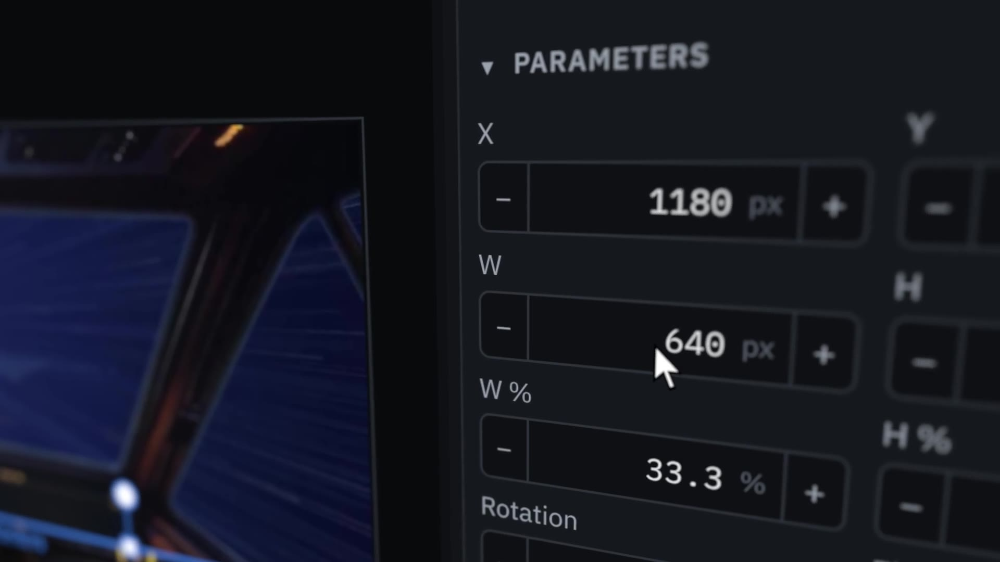

# Camera demos

Three short clips of JStream's 3D scene camera. Neither is a stream scene; they show what
the camera can do. All three were rendered from the JStream of
[#1157](https://github.com/jeffmhopkins/JStream/pull/1157) (camera motion and the follow
camera, on the alpha.4 wave).

| Clip | What it shows |
|---|---|
| [`media/depth-of-field.mp4`](media/depth-of-field.mp4) | Three cards at different depths in front of a wall and a floor. Depth of field turns on, the focus pulls from the middle card to the near one and then to the far one, and the blur grows and shrinks. The caption gives the focus distance and blur size of each frame. |
| [`media/screen-closeup.mp4`](media/screen-closeup.mp4) | A screenshot of the JStream web UI placed flat in a 3D scene, with the camera gliding between close, angled views of it: the selected item on the canvas, the inspector, the program's title, the scene list and the mixer. This is how a screen-capture close-up looks on a stream. |
| [`media/follow-cursor.mp4`](media/follow-cursor.mp4) | The follow camera (ADR-0113) on the same screenshot, chasing a scripted pointer for 27 seconds. The camera holds still while the pointer moves inside the dead zone, glides after it with a slight lean, pulls back on a fast flick, and zooms in and out on hotkey steps. |

## The screen

[`media/jstream-ui.png`](media/jstream-ui.png) is the screen both UI clips show. It is the
JStream web UI served by a Linux `jstream-daemon` built from #1157, with the Bridge scene's
live preview on the canvas and the Monitors item selected. It was captured at 1440 × 900
and scale 3.

[`build-showcase.py`](build-showcase.py) builds the daemon's small studio over MCP: three
scenes made from the [starship-cockpit](../starship-cockpit/) stills, plus a title.
[`capture-ui.js`](capture-ui.js) takes the screenshot with Playwright.

## How they were made

All three were rendered frame by frame by JStream's compositor (`jstream-render`) on
lavapipe, with each item carrying a scene camera, then encoded with ffmpeg (H.264, 30 fps).
They were run as ignored tests inside JStream's crates, not through the app.

- [`dof_reel.rs`](dof_reel.rs) renders the depth-of-field reel at 1280 × 720.
  [`make-textures.py`](make-textures.py) draws its wall, floor and cards. The caption was
  drawn onto each frame afterwards.
- [`screen_reel.rs`](screen_reel.rs) renders the close-up at 1920 × 1080. It holds six angles
  and glides between them, at the nearest distance that keeps the screen filling the frame.
- [`follow_track.rs`](follow_track.rs) runs inside `jstream-core`. It drives the engine's
  own follow camera (`Cameras::follow`, the code that draws a follow scene each frame) with a
  scripted pointer and the zoom steps `scene.zoom_camera` would send. It writes one camera
  per frame. [`follow_render.rs`](follow_render.rs) then renders that track in
  `jstream-render`, with the pointer drawn onto the screen's plane, as a capture draws it.

They are scratch code against JStream's internal APIs, kept for reference. They may not
build against a later JStream.

## The follow clip, frame by frame

The pointer stays in the frame for 89% of the clip. It leaves the frame in three places:

- **Fast flicks:** for about 0.4 s on each fast move, until the camera catches up.
- **Zooming out:** for about 0.4 s while the camera zooms out at the scene list, near the screen's left edge.
- **The Go Live button:** for about 1.7 s, the flick to it and most of the time the pointer rests there. The button sits 24 px from the screen's top corner.

The corner gap is the limit ADR-0113 records. Seen at an angle, the frame's outline on the
screen is skewed, and the camera keeps the screen filling the frame. So the outline can't
reach right into a corner. The earlier mock-up had the same gap.
