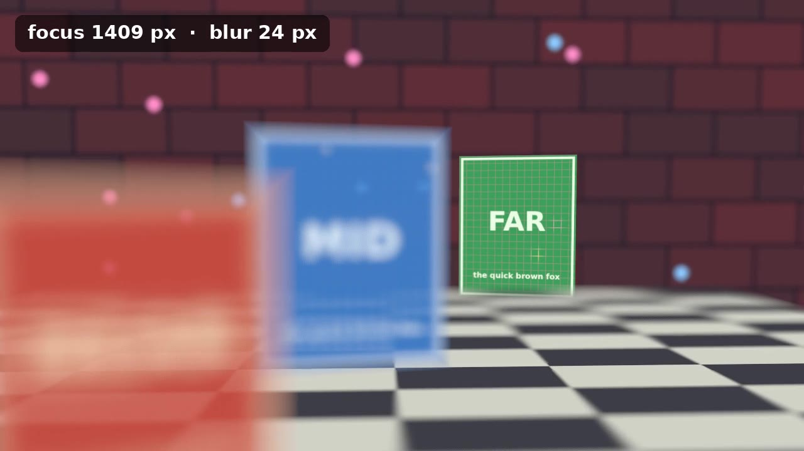
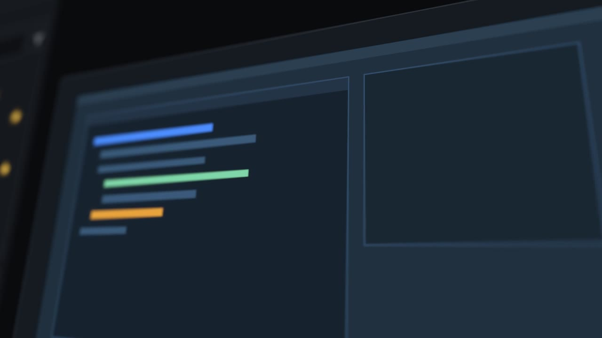

# Camera demos

Two short clips of JStream's scene camera: a 3D camera that moves through a scene, with
optional depth of field. Neither is a stream scene; they show what the camera can do.

| Clip | What it shows |
|---|---|
| [`media/depth-of-field.mp4`](media/depth-of-field.mp4) | Three cards at different depths in front of a wall and a floor. Depth of field turns on, the focus pulls from the middle card to the near one and then to the far one, and the blur grows and shrinks. The caption gives the focus distance and blur size of each frame. |
| [`media/screen-closeup.mp4`](media/screen-closeup.mp4) | A screenshot of the JStream UI placed flat in a 3D scene, with the camera gliding between close, angled views of it, the way a screen-capture close-up looks on a stream. |

## How they were made

Both were rendered frame by frame by JStream's compositor (`jstream-render`), with each
item carrying a scene camera, then encoded with ffmpeg. They were run as ignored tests
inside `jstream-render` against a GPU, not through the app.

- [`dof_reel.rs`](dof_reel.rs) renders the depth-of-field reel at 1280 × 720, 30 fps.
  [`make-textures.py`](make-textures.py) draws its wall, floor and cards.
- [`screen_reel.rs`](screen_reel.rs) renders the close-up at 1920 × 1080 from a 1440 × 900
  screenshot of the UI prototype.

They are scratch code against JStream's internal render API, kept for reference; they may
not build against a later JStream.
