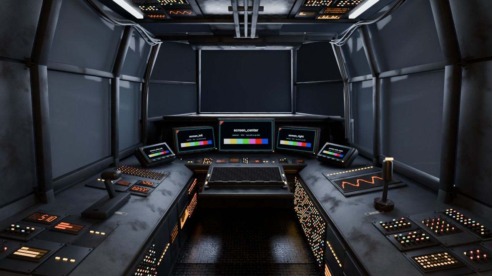
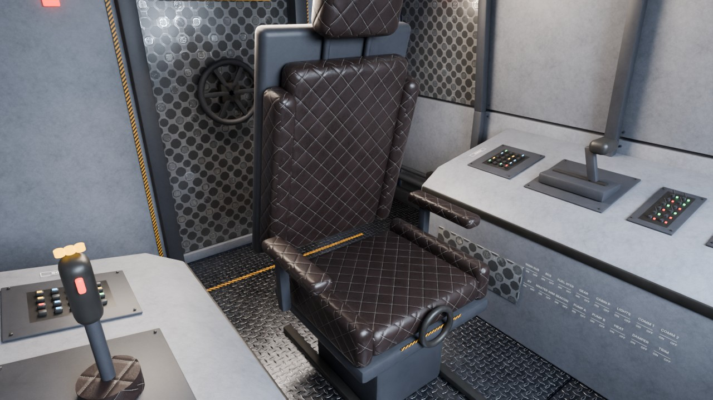

# 3D cockpit model

A single-seat starship cockpit as a real 3D model, for JStream's `model` source
(ADR-0107): glTF 2.0, metallic-roughness materials, six screens that are each their own
material so a live source can be mapped onto any of them. It is meant for camera moves
and depth of field inside the cockpit, close enough to read the button labels.



| | |
|---|---|
|  |  |
|  |  |


The stills are Blender Cycles renders of the same geometry and textures, lit with two area
lights and the model's own light strips. JStream lights the model with its own rig or the
scene's lights, so it will not look exactly like this there.

## Files

| Path | What it is |
|---|---|
| [`model/cockpit.gltf`](model/cockpit.gltf) | The model. Point a `model` source's `file` at it. Its `cockpit.bin` and `textures/` must stay beside it. |
| [`model/textures/`](model/textures/) | 22 images: five tiling PBR sets (colour, normal, occlusion-roughness-metalness), the decal atlas, and a placeholder card per screen. |
| [`model/CREDITS.md`](model/CREDITS.md) | Where every texture comes from, and its licence (all CC0). |
| [`tools/make_textures.py`](tools/make_textures.py) | Builds `textures/` from the ambientCG downloads, and draws the decals and screen cards. |
| [`tools/build_cockpit.py`](tools/build_cockpit.py) | Builds the model in Blender from code and exports it. |
| [`tools/finish_gltf.py`](tools/finish_gltf.py) | Wires the textures into the exported glTF. |
| [`tools/render_previews.py`](tools/render_previews.py) | Renders the stills above. |

## Numbers

Checked by loading the file with JStream's own glTF loader (`jstream-sources`), with its
real image decoders:

| | This model | JStream's cap |
|---|---|---|
| Triangles | 64,090 | 2,000,000 |
| Textures | 22, all 2048 px or smaller | 64, 4096 px a side |
| Memory (textures with mips) | 357 MiB | 512 MiB (with the mesh) |
| Extensions | `KHR_materials_unlit`, `KHR_materials_emissive_strength` | both read |
| Compression | none (no Draco, meshopt or KTX2) | none read |

Nothing in the file was reported as ignored.

## Why it stays sharp up close

No surface has one unique texture stretched over it. Every surface uses one of five
tiling 2048 px texture sets, with texture coordinates projected from world position in
metres, so the detail per metre is the same everywhere and doesn't depend on how big a
part is:

| Set | Used for | Repeats every | Texels per cm |
|---|---|---|---|
| `paint` | walls, consoles, ceiling, frames (`paint_dark` is the same set darkened) | 50 cm | 41 |
| `floor` | the deck | 60 cm | 34 |
| `leather` | seat, armrests, stick boot | 30 cm | 68 |
| `plastic` | bezels, buttons, grips, trim | 40 cm | 51 |
| `hexpanel` | vents, hatch, ceiling and wall insets | 50 cm | 41 |

A 2 cm button fills a 1080p frame at a ~5 cm field of view and still has about 100 texels
across it. Bevels, bolts, buttons and switches are real geometry, not normal-map detail,
so their edges stay sharp at any distance. Labels and stripes come from one 2048 px decal
atlas, at 3 to 6 texels per mm on the panels that carry them.

## Layout

The model is in metres, glTF axes: **+x right, +y up, +z toward the back of the cabin**.
The pilot faces **−z**, toward the windshield. The deck is at y = 0. In JStream's model
source, glTF +z is toward the viewer, so the default view looks at the back of the seat
toward the windshield.

| Part (node) | Where |
|---|---|
| Whole cabin | x −1.40 to 1.40, y 0 to 2.20, z −2.02 (windshield base) to 1.76 (rear bulkhead) |
| Pilot's eye point | about (0, 1.22, 0.45), looking toward −z |
| `seat` | centred on x = 0, from z −0.10 to 0.84; headrest top at y 1.56 |
| `windshield` | three panes (material `glass`, alpha-blended) in a frame leaning back: the bottom edge at y 1.16, z −2.02; the top edge at y 2.16, z −1.25. The centre pane spans x −0.62 to 0.62; the side panes x ±0.70 to ±1.08. Whatever is behind the model in the scene shows through. |
| `dashboard` | across the front, under the windshield; top at y ≈ 0.67 |
| `side_consoles` | either side of the seat, x ±0.62 to ±1.35, z −1.18 to 0.75; throttle on the left, side stick on the right |
| `overhead_panel` | hanging from the ceiling above the dashboard |
| `rear_bulkhead` | behind the seat, with a hatch |
| `cabin` | walls, ribs, ceiling with light strips, floor, pipes |

### Screens

Each screen is its own node **and** its own material, with the same name. Its texture
coordinates cover the whole image once, with the image's top-left at the screen's
top-left as the pilot sees it, at 16:9, so a 1920 × 1080 source maps without stretching.
Screen materials are `KHR_materials_unlit`: a source on a screen shows at its own colours,
like a display, whatever the lighting. Until a live source replaces one, it shows a test
card with its name.

| Material / node | Size (m) | Top-left | Top-right | Bottom-left | Bottom-right | Faces |
|---|---|---|---|---|---|---|
| `screen_center` | 0.720 × 0.405 | (−0.360, 1.136, −1.489) | (0.360, 1.136, −1.489) | (−0.360, 0.744, −1.391) | (0.360, 0.744, −1.391) | (0, 0.24, 0.97) |
| `screen_left` | 0.500 × 0.281 | (−0.894, 1.036, −1.264) | (−0.461, 1.036, −1.514) | (−0.859, 0.764, −1.206) | (−0.426, 0.764, −1.456) | (0.49, 0.24, 0.84) |
| `screen_right` | 0.500 × 0.281 | (0.461, 1.036, −1.514) | (0.894, 1.036, −1.264) | (0.426, 0.764, −1.456) | (0.859, 0.764, −1.206) | (−0.49, 0.24, 0.84) |
| `screen_side_left` | 0.300 × 0.169 | (−1.114, 0.914, −0.767) | (−0.955, 0.914, −1.021) | (−1.005, 0.806, −0.699) | (−0.846, 0.806, −0.953) | (0.55, 0.77, 0.34) |
| `screen_side_right` | 0.300 × 0.169 | (0.955, 0.914, −1.021) | (1.114, 0.914, −0.767) | (0.846, 0.806, −0.953) | (1.005, 0.806, −0.699) | (−0.55, 0.77, 0.34) |
| `screen_overhead` | 0.340 × 0.191 | (−0.170, 1.991, −0.707) | (0.170, 1.991, −0.707) | (−0.170, 1.869, −0.853) | (0.170, 1.869, −0.853) | (0, −0.77, 0.64) |

To put a live source on a screen, give the model source `texture` = that source and
`texture_material` = the screen's material name (ADR-0107 decision 5). Where a model
source can't do that yet, a flat card placed on the corners above does the same job.

### All materials

`paint`, `paint_dark`, `floor`, `leather`, `plastic`, `hexpanel` (tiling PBR sets),
`glass` (blended), `decals` (alpha-masked labels and stripes), `light_strip` and
`led_green`, `led_amber`, `led_red`, `led_blue` (emissive), and the six `screen_*`
materials above.

## Rebuilding it

```sh
pip install bpy pillow numpy        # Blender as a Python module (5.x), and Pillow
# Download the 2K-JPG zip of each ambientCG asset in model/CREDITS.md and unpack each
# into its own folder named after the asset, under dl/.
python tools/make_textures.py dl model/textures
python tools/build_cockpit.py model/textures model/cockpit.gltf --blend cockpit.blend
python tools/finish_gltf.py model/cockpit.gltf
python tools/render_previews.py cockpit.blend media 48 1280
```

`build_cockpit.py` is plain code: boxes, extruded profiles and cylinders, bevelled, then
joined into one node per part. Change a dimension there and rebuild; the screen table
above comes from the `SCREENS` table at its top.
