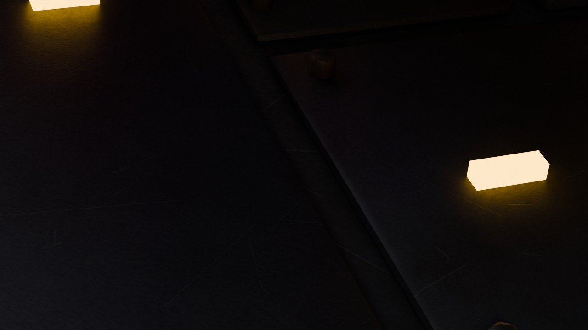

# 3D cockpit model

A starship flight deck as a real 3D model, for JStream's `model` source (ADR-0107):
glTF 2.0, metallic-roughness materials, seven 16:9 screens and a desk instrument that are
each their own material so a live source can be mapped onto any of them. It is meant for camera moves
and depth of field inside the cockpit, close enough to read the readouts.

The look is a weathered aircraft flight deck in space: worn grey-green paint with grime
and scratches, a wide panoramic windshield and an angled window each side in thick
pillars, three equal monitors wrapped around the pilot under the windshield in chunky
moulded hoods, an overhead console with two more screens, and amber readouts, button
banks, switches and knobs around a tray in front of the pilot. There is no seat, so the
camera can sit where a pilot would. On the tray, right under the monitors, lies a grid
instrument that looks switched off until a live source is put on it. The layout follows
the green-screen plate of [starship-cockpit](../starship-cockpit/).


| | |
|---|---|
|  |  |
|  |  |
|  |  |



The stills are Blender Cycles renders of the same geometry and textures, lit with two area
lights, the model's own light strips and LEDs, and a starfield behind the glass. JStream lights the model with its own rig or the
scene's lights, so it will not look exactly like this there.

## Files

| Path | What it is |
|---|---|
| [`model/cockpit.gltf`](model/cockpit.gltf) | The model. Point a `model` source's `file` at it. Its `cockpit.bin` and `textures/` must stay beside it. |
| [`model/throttle.gltf`](model/throttle.gltf) | The throttle lever by itself, so a scene can move it. It uses the same `textures/`. See [The throttle lever](#the-throttle-lever). |
| [`model/textures/`](model/textures/) | 25 images: five tiling PBR sets (colour, normal, occlusion-roughness-metalness), the decal atlas, the amber readout atlas, and a placeholder card per screen. |
| [`model/CREDITS.md`](model/CREDITS.md) | Where every texture comes from, and its licence (all CC0). |
| [`tools/make_textures.py`](tools/make_textures.py) | Builds `textures/` from the ambientCG downloads (baking the grime and scratches into the paint set), and draws the decals, readouts and screen cards. |
| [`tools/build_cockpit.py`](tools/build_cockpit.py) | Builds the model in Blender from code and exports it. |
| [`tools/finish_gltf.py`](tools/finish_gltf.py) | Wires the textures into the exported glTF. |
| [`tools/render_previews.py`](tools/render_previews.py) | Renders the stills above. |

## Numbers

Checked by loading the file with JStream's own glTF loader (`jstream-sources`), with its
real image decoders:

| | This model | JStream's cap |
|---|---|---|
| Triangles | 168,394 | 2,000,000 |
| Textures | 25, all 2048 px or smaller | 64, 4096 px a side |
| Memory | 386 MiB of textures with mips, about 14 MiB of mesh: about 400 MiB | 512 MiB |
| Extensions | `KHR_materials_unlit`, `KHR_materials_emissive_strength` | both read |
| Compression | none (no Draco, meshopt or KTX2) | none read |

Nothing in the file was reported as ignored. `throttle.gltf` loads the same way: 408
triangles, and its own copy of the `paint` and `plastic` sets, 128 MiB.

## Why it stays sharp up close

No surface has one unique texture stretched over it. Every surface uses one of five
tiling 2048 px texture sets, with texture coordinates projected from world position in
metres, so the detail per metre is the same everywhere and doesn't depend on how big a
part is:

| Set | Used for | Repeats every | Texels per cm |
|---|---|---|---|
| `paint` | walls, consoles, ceiling, frames; grey-green with baked grime, mottling and scratches (`paint_dark` is the same set darkened) | 50 cm | 41 |
| `floor` | the deck | 60 cm | 34 |
| `leather` | stick boots, some cable looms | 30 cm | 68 |
| `plastic` | bezels, buttons, grips, trim | 40 cm | 51 |
| `hexpanel` | vents, hatch, roof and wall insets | 50 cm | 41 |

A 2 cm button fills a 1080p frame at a ~5 cm field of view and still has about 100 texels
across it. Bevels, bolts, buttons and switches are real geometry, not normal-map detail,
so their edges stay sharp at any distance. Labels and stripes come from one 2048 px decal
atlas, at 3 to 6 texels per mm on the panels that carry them. Each amber readout is one
256 × 128 px cell of the readout atlas on a display 4 to 25 cm wide.

## Layout

The model is in metres, glTF axes: **+x right, +y up, +z toward the back of the cabin**.
The pilot faces **−z**, toward the windshield. The deck is at y = 0. In JStream's model
source, glTF +z is toward the viewer, so the default view looks from the back of the
cabin toward the windshield.

| Part (node) | Where |
|---|---|
| Whole cabin | x −1.13 to 1.13, y 0 to 1.91, z −1.75 (windshield base) to 1.16 (rear bulkhead) |
| Pilot's eye point | about (0, 1.22, 0), looking toward −z |
| `windshield` | the canopy and the hull under it. One wide raked windshield: its base at the sill, y 0.95, z −1.70, x ±0.88; its top at the roof, y 1.85, z −0.85, x ±0.73, with a gusset across each corner. One side window each side, from the windshield back to the B-pillar at z 0.10 (x ±1.05 at the sill, ±0.82 at the roof). Thick pillars with trim and an amber marker at each foot, the roof over the pilot, and the opaque cheeks and nose below the sill. |
| `header` | the overhead console under the roof at the top of the windshield, z ≈ −0.8: a switch panel and a lamp between the two overhead screens, which are each aimed at the pilot's eyes |
| `dashboard` | the three hooded monitors, the centre one at z ≈ −1.44 and the outer two turned 22° inward; the sloped console below them (y 0.62 at z −0.65 up to y 0.79 at z −1.37), a strip ahead of the tray and a wing each side, x ±0.45 to ±0.84; the tray, z −0.76 to −1.12 at y ≈ 0.59 to 0.67, on two arms, with an arm rest each side |
| `side_consoles` | either side, x ±0.78 to ±1.03, z −0.65 to 0.70; the throttle's base and slot on the left (the lever is `throttle.gltf`), side stick on the right; a ledge under each side window |
| `conduits` | behind the pilot: cable looms along the roof edges, roof conduits, greebled roof and lower-wall panels |
| `rear_bulkhead` | the back wall, with a hatch |
| `cabin` | the walls and roof behind the side windows, light strips, floor, pipes |

All glass is the one `glass` material (alpha-blended, nearly clear): whatever is behind the
model in the scene shows through every window. There is no seat and no centre
console; the floor from the tray back (x ±0.75, z −0.6 to 1.1) is clear for the camera.

### Screens

Each screen is its own node **and** its own material, with the same name. Its texture
coordinates cover the whole image once, with the image's top-left at the screen's
top-left as the pilot sees it, at 16:9, so a 1920 × 1080 source maps without stretching.
Screen materials are `KHR_materials_unlit`: a source on a screen shows at its own colours,
like a display, whatever the lighting. Until a live source replaces one, it shows a test
card with its name.

| Material / node | Size (m) | Top-left | Top-right | Bottom-left | Bottom-right | Faces |
|---|---|---|---|---|---|---|
| `screen_center` | 0.520 × 0.292 | (−0.260, 1.114, −1.465) | (0.260, 1.114, −1.465) | (−0.260, 0.826, −1.415) | (0.260, 0.826, −1.415) | (0, 0.17, 0.98) |
| `screen_left` | 0.520 × 0.292 | (−0.811, 1.114, −1.261) | (−0.328, 1.114, −1.456) | (−0.792, 0.826, −1.214) | (−0.309, 0.826, −1.409) | (0.37, 0.17, 0.91) |
| `screen_right` | 0.520 × 0.292 | (0.328, 1.114, −1.456) | (0.811, 1.114, −1.261) | (0.309, 0.826, −1.409) | (0.792, 0.826, −1.214) | (−0.37, 0.17, 0.91) |
| `screen_side_left` | 0.220 × 0.124 | (−1.024, 0.900, −0.406) | (−0.967, 0.900, −0.619) | (−0.933, 0.820, −0.381) | (−0.876, 0.820, −0.594) | (0.62, 0.77, 0.17) |
| `screen_side_right` | 0.220 × 0.124 | (0.967, 0.900, −0.619) | (1.024, 0.900, −0.406) | (0.876, 0.820, −0.594) | (0.933, 0.820, −0.381) | (−0.62, 0.77, 0.17) |
| `screen_overhead_left` | 0.300 × 0.169 | (−0.519, 1.772, −0.658) | (−0.245, 1.772, −0.780) | (−0.555, 1.628, −0.740) | (−0.281, 1.628, −0.862) | (0.34, −0.53, 0.77) |
| `screen_overhead_right` | 0.300 × 0.169 | (0.245, 1.772, −0.780) | (0.519, 1.772, −0.658) | (0.281, 1.628, −0.862) | (0.555, 1.628, −0.740) | (−0.34, −0.53, 0.77) |
| `screen_desk` | 0.720 × 0.270 (8:3) | (−0.360, 0.718, −1.052) | (0.360, 0.718, −1.052) | (−0.360, 0.662, −0.788) | (0.360, 0.662, −0.788) | (0, 0.98, 0.21) |

`screen_desk` is the playing surface of the instrument on the tray. It is the one screen
that is not 16:9: it is 8:3, the shape of a long grid controller seen from above, so crop
the source to the instrument. Its placeholder is a dark 24 × 8 grid of pads, so the
instrument reads as switched off until a live source (a top-down camera on the real
instrument, say) replaces it. To switch it off again, take the source off the material:
ADR-0107 says a named source that isn't drawing reads transparent, not as the placeholder.

To put a live source on a screen, give the model source `texture` = that source and
`texture_material` = the screen's material name (ADR-0107 decision 5). Where a model
source can't do that yet, a flat card placed on the corners above does the same job.

### The throttle lever

JStream can't move one node inside a model, so the lever (shaft and grip) is not in
`cockpit.gltf`. It is `throttle.gltf`, a second model to place in the scene, with its
origin at the hinge inside the base. It is modelled upright, at the middle of its travel.

| | |
|---|---|
| Hinge (pivot), in the cockpit's coordinates | (−0.930, 0.737, −0.150) |
| Hinge axis | the cockpit's x axis: the grip swings toward −z (forward) or +z (back) |
| Travel | −25° to +25° from upright; the slot in the base is 24 cm long |
| Size | 0.120 × 0.220 × 0.080 m (x, y, z) |
| Bounds centre, from the pivot | (0, 0.110, 0): the lever stands on its pivot |

To animate it, put the lever in a group whose centre is the pivot, offset the lever by
its bounds centre, and tilt the group.

### All materials

`paint`, `paint_dark`, `floor`, `leather`, `plastic`, `hexpanel` (tiling PBR sets),
`glass` (blended), `decals` (alpha-masked labels and stripes), `readout` (the amber
displays, emissive from the readout atlas), `light_strip` and `led_amber`, `led_red`,
`led_green`, `led_blue` (emissive), and the eight `screen_*` materials above.

## Rebuilding it

```sh
pip install bpy pillow numpy        # Blender as a Python module (5.x), and Pillow
# Download the 2K-JPG zip of each ambientCG asset in model/CREDITS.md and unpack each
# into its own folder named after the asset, under dl/.
python tools/make_textures.py dl model/textures
python tools/build_cockpit.py model/textures model/cockpit.gltf --blend cockpit.blend
python tools/finish_gltf.py model/cockpit.gltf
python tools/render_previews.py cockpit.blend media 48 1280
```

`build_cockpit.py` is plain code: boxes, extruded profiles and cylinders, bevelled, then
joined into one node per part. Change a dimension there and rebuild; the screen table
above comes from the `SCREENS` table at its top.
