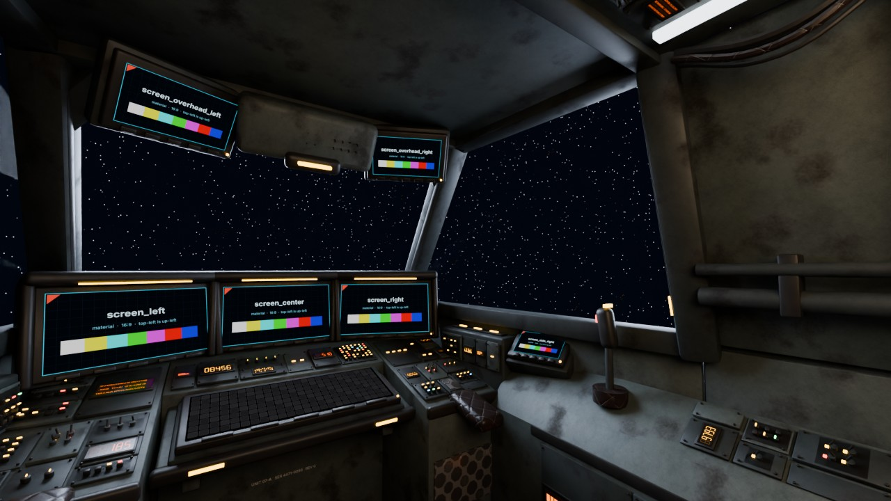
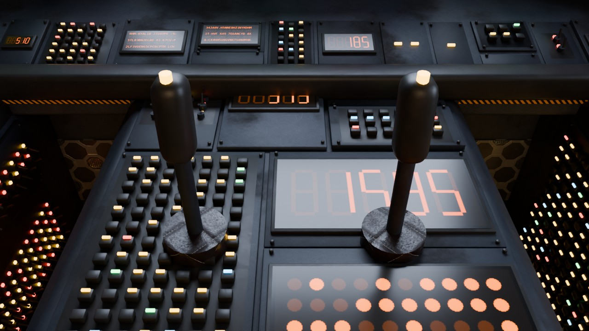
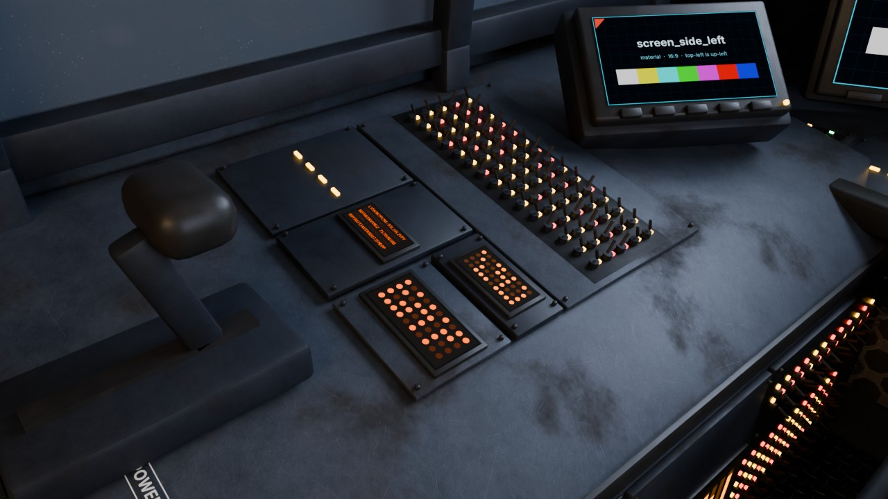
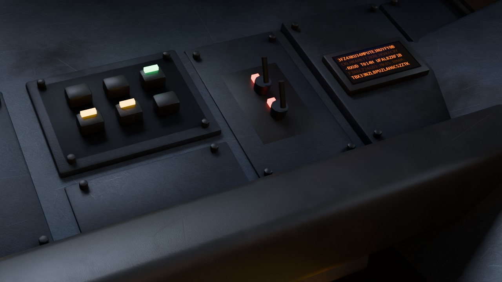
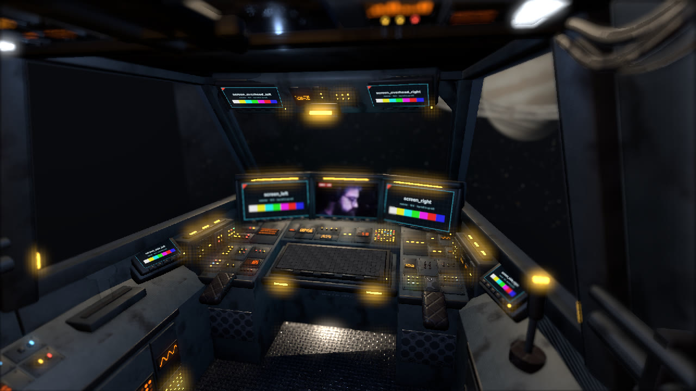
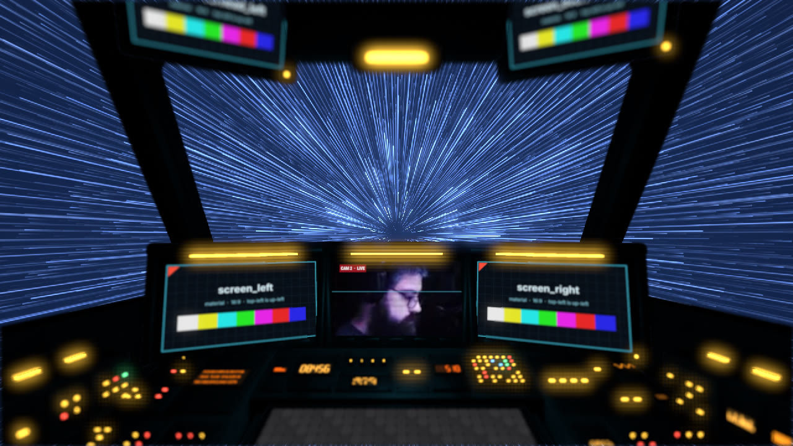

# 3D cockpit model

A starship flight deck as a real 3D model, for JStream's `model` source (ADR-0107):
glTF 2.0, metallic-roughness materials, and five 16:9 screens that are each their own
material so a live source can be mapped onto any of them. It is meant for camera moves
and depth of field inside the cockpit, close enough to read the readouts.

The look follows the green-screen plate of [starship-cockpit](../starship-cockpit/)
and the "used future" of working-ship sets: dark gunmetal paint with grime and scratches,
glass that wraps from the windshield back along both sides, and every console covered in
greebled sub-panels, amber readouts, button banks, switches, knobs and vents, with cable
looms and conduits on the roof. There is no seat, so the camera can sit where a pilot
would.


| | |
|---|---|
|  |  |
|  |  |
|  | |


The stills are Blender Cycles renders of the same geometry and textures, lit with two area
lights, the model's own light strips and LEDs, and a starfield behind the glass. JStream lights the model with its own rig or the
scene's lights, so it will not look exactly like this there.

## Files

| Path | What it is |
|---|---|
| [`model/cockpit.gltf`](model/cockpit.gltf) | The model. Point a `model` source's `file` at it. Its `cockpit.bin` and `textures/` must stay beside it. |
| [`model/textures/`](model/textures/) | 22 images: five tiling PBR sets (colour, normal, occlusion-roughness-metalness), the decal atlas, the amber readout atlas, and a placeholder card per screen. |
| [`model/CREDITS.md`](model/CREDITS.md) | Where every texture comes from, and its licence (all CC0). |
| [`tools/make_textures.py`](tools/make_textures.py) | Builds `textures/` from the ambientCG downloads (baking the grime and scratches into the paint set), and draws the decals, readouts and screen cards. |
| [`tools/build_cockpit.py`](tools/build_cockpit.py) | Builds the model in Blender from code and exports it. |
| [`tools/finish_gltf.py`](tools/finish_gltf.py) | Wires the textures into the exported glTF. |
| [`tools/render_previews.py`](tools/render_previews.py) | Renders the stills above. |

## Numbers

Checked by loading the file with JStream's own glTF loader (`jstream-sources`), with its
real image decoders:

| | This model | JStream's cap |
|---|---|---|
| Triangles | 404,014 | 2,000,000 |
| Textures | 22, all 2048 px or smaller | 64, 4096 px a side |
| Memory | 376 MiB of textures with mips, 37 MiB of mesh: 413 MiB | 512 MiB |
| Extensions | `KHR_materials_unlit`, `KHR_materials_emissive_strength` | both read |
| Compression | none (no Draco, meshopt or KTX2) | none read |

Nothing in the file was reported as ignored.

## Why it stays sharp up close

No surface has one unique texture stretched over it. Every surface uses one of five
tiling 2048 px texture sets, with texture coordinates projected from world position in
metres, so the detail per metre is the same everywhere and doesn't depend on how big a
part is:

| Set | Used for | Repeats every | Texels per cm |
|---|---|---|---|
| `paint` | walls, consoles, ceiling, frames; gunmetal with baked grime, mottling and scratches (`paint_dark` is the same set darkened) | 50 cm | 41 |
| `floor` | the deck | 60 cm | 34 |
| `leather` | stick boots, some cable looms | 30 cm | 68 |
| `plastic` | bezels, buttons, grips, trim | 40 cm | 51 |
| `hexpanel` | vents, hatch, roof and wall insets | 50 cm | 41 |

A 2 cm button fills a 1080p frame at a ~5 cm field of view and still has about 100 texels
across it. Bevels, bolts, buttons and switches are real geometry, not normal-map detail,
so their edges stay sharp at any distance. Labels and stripes come from one 2048 px decal
atlas, at 3 to 6 texels per mm on the panels that carry them. Each amber readout is one
256 × 128 px cell of the readout atlas on a display 4 to 25 cm wide.

## Layout

The model is in metres, glTF axes: **+x right, +y up, +z toward the back of the cabin**.
The pilot faces **−z**, toward the windshield. The deck is at y = 0. In JStream's model
source, glTF +z is toward the viewer, so the default view looks from the back of the
cabin toward the windshield.

| Part (node) | Where |
|---|---|
| Whole cabin | x −1.40 to 1.40, y 0 to 2.20, z −2.02 (windshield base) to 1.76 (rear bulkhead) |
| Pilot's eye point | about (0, 1.22, 0.45), looking toward −z |
| `windshield` | three front panes in a frame leaning back: the bottom edge at y 1.16, z −2.02; the top edge at y 2.16, z −1.25. The centre pane spans x −0.78 to 0.78; the side panes x ±0.84 to ±1.02. Also the glass cheeks that join it to the side windows. |
| Side windows (in `cabin`) | glass on both walls from the console sill (y 0.85) to the roof (y 2.16), from z 0.15 forward to the windshield, split by ribs at z −0.62 and −1.25 and a transom at y 1.65 |
| `header` | the lit, greebled header across the top of the windshield |
| `dashboard` | across the front, under the windshield; top at y ≈ 0.67; greebled banks between the lip and the screens |
| `center_console` | between the pilot's knees, x −0.36 to 0.36, z −1.18 to −0.35, top at y 0.60, with two sticks |
| `side_consoles` | either side, x ±0.62 to ±1.35, z −1.18 to 0.75; throttle on the left, side stick on the right; greebled tops and inner faces |
| `conduits` | cable looms along the roof edges and down the pillars, roof conduits, greebled roof and rear-wall panels |
| `rear_bulkhead` | the back wall, with a hatch |
| `cabin` | walls, ribs, roof with light strips, floor, pipes, the side windows |

All glass is the one `glass` material (alpha-blended, nearly clear): whatever is behind the
model in the scene shows through every window. There is no seat; the space where one
would be (around x 0, z 0 to 0.8) is clear for the camera.

### Screens

Each screen is its own node **and** its own material, with the same name. Its texture
coordinates cover the whole image once, with the image's top-left at the screen's
top-left as the pilot sees it, at 16:9, so a 1920 × 1080 source maps without stretching.
Screen materials are `KHR_materials_unlit`: a source on a screen shows at its own colours,
like a display, whatever the lighting. Until a live source replaces one, it shows a test
card with its name.

| Material / node | Size (m) | Top-left | Top-right | Bottom-left | Bottom-right | Faces |
|---|---|---|---|---|---|---|
| `screen_center` | 0.720 × 0.405 | (−0.360, 1.136, −1.489) | (0.360, 1.136, −1.489) | (−0.360, 0.744, −1.391) | (0.360, 0.744, −1.391) | (0, 0.24, 0.97) |
| `screen_left` | 0.500 × 0.281 | (−0.894, 1.036, −1.264) | (−0.461, 1.036, −1.514) | (−0.859, 0.764, −1.206) | (−0.426, 0.764, −1.456) | (0.49, 0.24, 0.84) |
| `screen_right` | 0.500 × 0.281 | (0.461, 1.036, −1.514) | (0.894, 1.036, −1.264) | (0.426, 0.764, −1.456) | (0.859, 0.764, −1.206) | (−0.49, 0.24, 0.84) |
| `screen_side_left` | 0.300 × 0.169 | (−1.114, 0.914, −0.767) | (−0.955, 0.914, −1.021) | (−1.005, 0.806, −0.699) | (−0.846, 0.806, −0.953) | (0.55, 0.77, 0.34) |
| `screen_side_right` | 0.300 × 0.169 | (0.955, 0.914, −1.021) | (1.114, 0.914, −0.767) | (0.846, 0.806, −0.953) | (1.005, 0.806, −0.699) | (−0.55, 0.77, 0.34) |

To put a live source on a screen, give the model source `texture` = that source and
`texture_material` = the screen's material name (ADR-0107 decision 5). Where a model
source can't do that yet, a flat card placed on the corners above does the same job.

### All materials

`paint`, `paint_dark`, `floor`, `leather`, `plastic`, `hexpanel` (tiling PBR sets),
`glass` (blended), `decals` (alpha-masked labels and stripes), `readout` (the amber
displays, emissive from the readout atlas), `light_strip` and `led_amber`, `led_red`,
`led_green`, `led_blue` (emissive), and the five `screen_*` materials above.

## In JStream

[`jstream/`](jstream/) builds a 3D scene around the model in a running JStream engine,
over its MCP endpoint, and plays a camera tour of it.


[The tour as video (MP4)](media/jstream-tour.mp4)

| | |
|---|---|
|  |  |
|  |  |
|  |  |

What it shows:

- **A live source on a screen.** A 2D scene, `feed` (a camera still, a tag and a scan
  bar sweeping down it), is a `scene` source mapped onto `screen_center` with the model
  source's `texture` and `texture_material`. Anything a scene can hold, a real camera
  included, can go there.
- **Depth of field on the model itself.** Each shot's camera has a focus; the model is
  blurred by the depth of each pixel it draws, so the dash and the window frame soften
  while the camera looks past them (JStream ADR-0165), and the monitor is sharp when it
  is in focus.
- **Keyframed 3D camera moves.** Each shot is a keyframe variant of the `cockpit` scene
  holding a full 3D camera (position, target, field of view, focus, blur). Switching
  with a `move` preset glides every field together, eased.
- **Scene lights and depth-aware filters.** Starlight through the windshield with
  shadows, cabin and screen-glow point lights, an environment sky, ambient occlusion
  and depth bloom.
- **A plate far outside.** `starship-cockpit/pages/planet.jpg` as a card 40 m past the
  windshield, seen through the glass.
- **A second model.** The throttle lever, `model/throttle.gltf`, placed at its hinge.
- **A deep-space sky and the jump to warp.** The environment light is also the backdrop
  (JStream ADR-0167): stars, nebulae and a galaxy band, infinitely far behind the
  cabin, seen through every window and lighting the model. The `warp` shot dims the
  cabin, sun, fill and rear lights to nothing through their items' opacity, so only the
  screens, the LEDs and the streaking sky light the cockpit, and `drive.py` sets the
  sky's `warp` as it switches, which the sky ramps to by itself. `SKY=0` builds without
  the backdrop, for a JStream without it.

| File | What it does |
|---|---|
| [`jstream/build_scene.py`](jstream/build_scene.py) | Builds the `feed` and `cockpit` scenes, the lights, filters, the shot variants and the glide presets. |
| [`jstream/shots.py`](jstream/shots.py) | Where the model sits in the scene, and the four shots' cameras, in model metres. It reads the model's bounds and `screen_center` from the glTF, and the eye point and throttle hinge from this README, so the shots follow the model when it changes. `COCKPIT_MODEL` points it at another copy. |
| [`jstream/drive.py`](jstream/drive.py) | Plays the tour live on program and records it (`record` output, H.264), with the jump to warp and back. |
| [`jstream/render_frames.py`](jstream/render_frames.py) | Renders the tour frame by frame through `video.snapshot`, for a machine too slow to composite it live. |
| [`jstream/snap_shot.py`](jstream/snap_shot.py) | Puts one shot on program and saves a snapshot. |
| [`jstream/mcp.py`](jstream/mcp.py) | A small MCP client for the engine's HTTP endpoint. |

```sh
cd cockpit-3d/jstream
export JS_TOKEN=<the engine's token file> JS_MCP=http://127.0.0.1:4455/mcp
python3 build_scene.py
python3 drive.py                     # on a machine with a GPU: records cockpit-slow.mp4
```

How the media here was made: the test machine had no GPU, so JStream composited on the
lavapipe software rasterizer, at a few seconds a frame with depth of field on the model.
`render_frames.py` stepped the camera through the same tour, with the same per-field
ease-in-out a `move` preset applies, and saved a snapshot a frame; ffmpeg joined them at
30 fps. Snapshots are at most 1280 px wide, so the media is 1280 × 720; the canvas, and a
recording, is 1920 × 1080. Every frame is a real JStream composite.

The warp is in the stills but not the frame-by-frame tour: the sky advances its streaks
by the engine's real time, a frame at a time, and a snapshot every two seconds is too
far apart for it to stream. `drive.py` plays the jump live, on a machine that can.

It needs a JStream with live model textures (ADR-0107's `texture`) and depth of field on
models (ADR-0165).

## Rebuilding it

```sh
pip install bpy pillow numpy        # Blender as a Python module (5.x), and Pillow
# Download the 2K-JPG zip of each ambientCG asset in model/CREDITS.md and unpack each
# into its own folder named after the asset, under dl/.
python tools/make_textures.py dl model/textures
python tools/build_cockpit.py model/textures model/cockpit.gltf --blend cockpit.blend
python tools/finish_gltf.py model/cockpit.gltf
python tools/render_previews.py cockpit.blend media 48 1280
```

`build_cockpit.py` is plain code: boxes, extruded profiles and cylinders, bevelled, then
joined into one node per part. Change a dimension there and rebuild; the screen table
above comes from the `SCREENS` table at its top.
