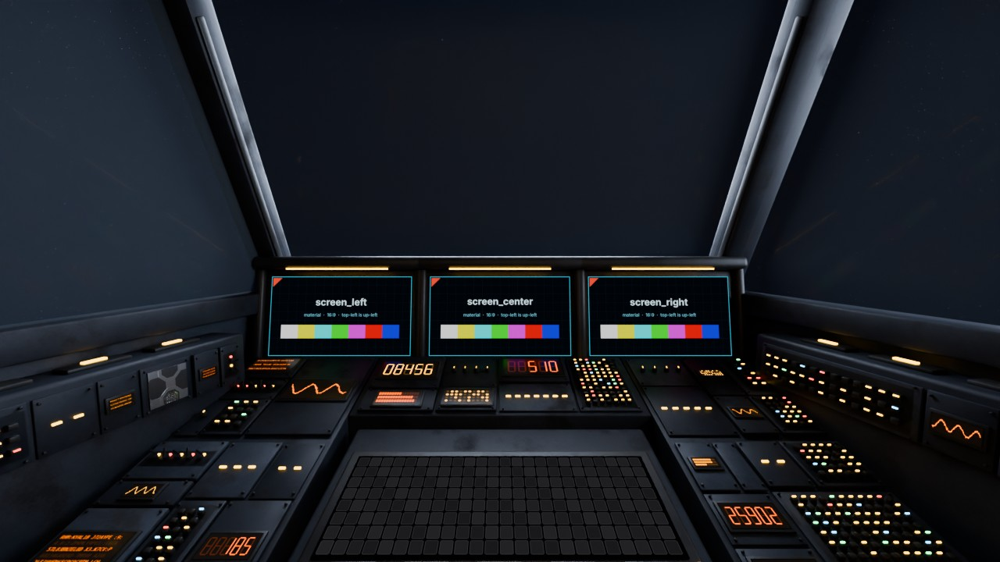
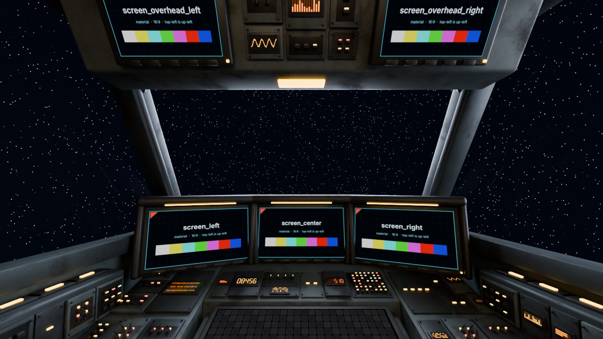
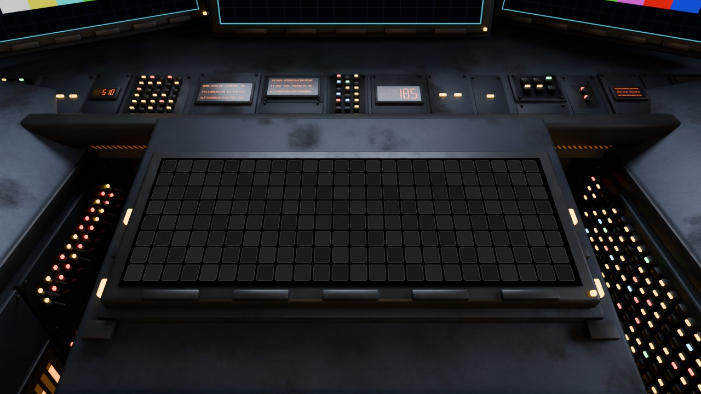
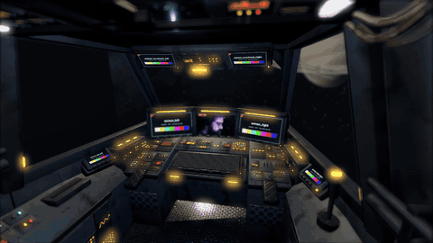
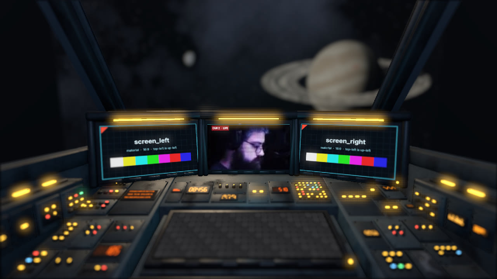
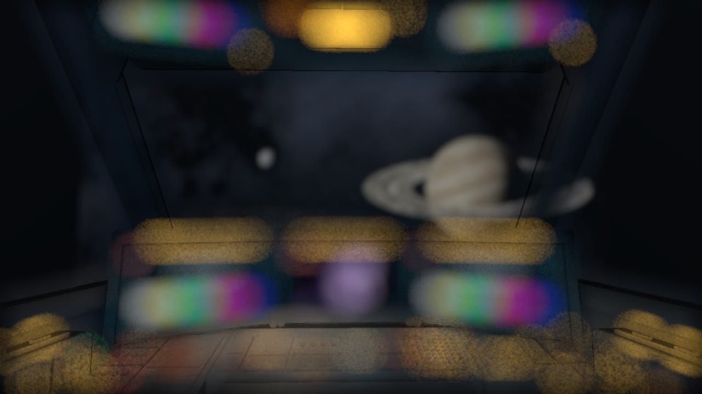
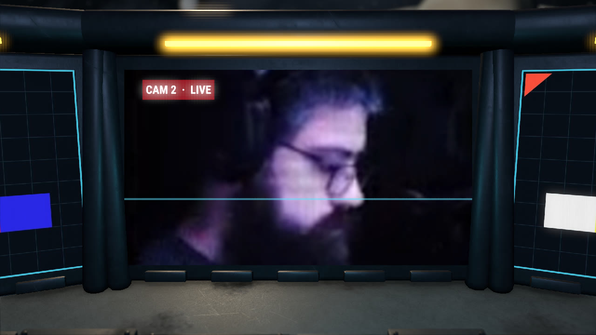
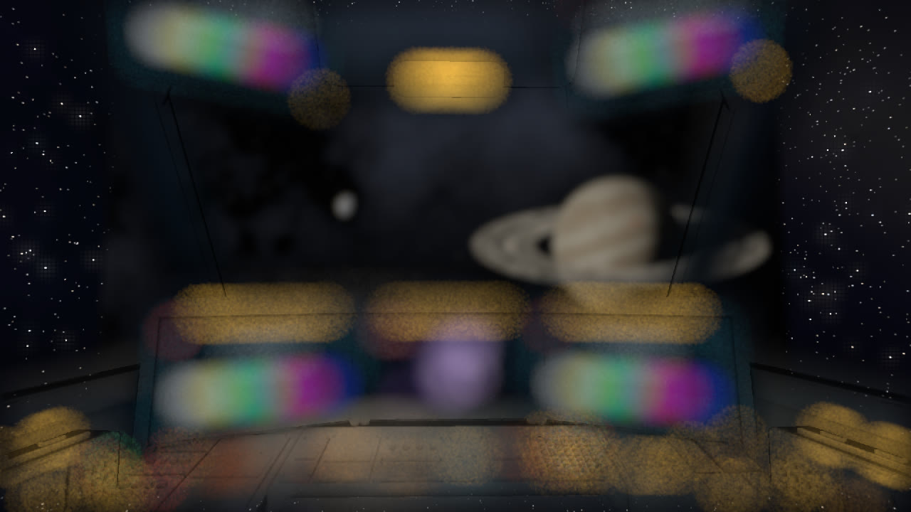
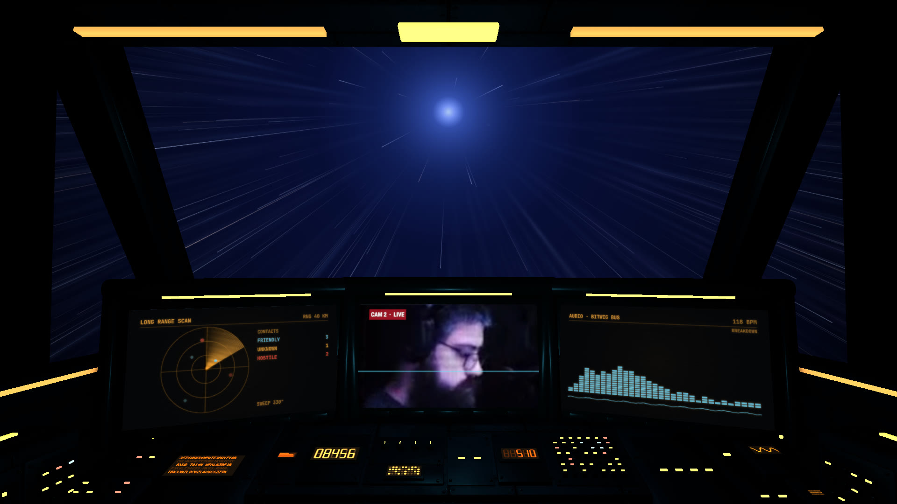
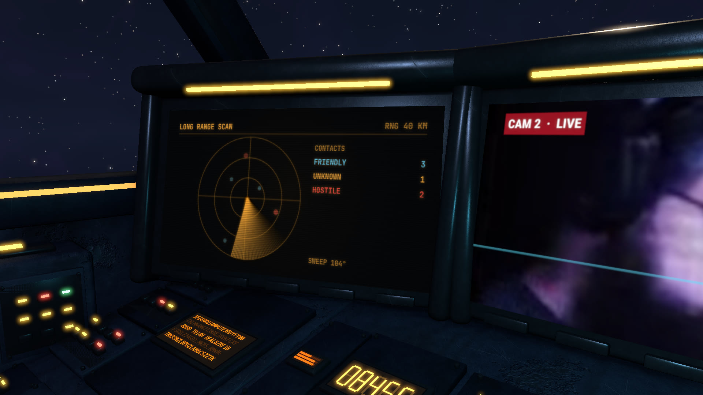

# 3D cockpit model

A starship flight deck as a real 3D model, for JStream's `model` source (ADR-0107):
glTF 2.0, metallic-roughness materials, seven 16:9 screens and a desk instrument that
share one material and one atlas image, so a single live source can fill all of them. It is meant for camera moves
and depth of field inside the cockpit, close enough to read the readouts.

The look follows the 2D [starship-cockpit](../starship-cockpit/) plate: dark blue-grey
painted metal panelling with seams, rivets, chipped edges and grime, amber indicator
lights all over the consoles, dim orange glow strips along the pillars and sills, and
glossy bezels that catch the light from outside. The shape is an aircraft flight deck: a
wide panoramic windshield and an angled window each side in thick pillars, three equal
monitors wrapped around the pilot in chunky moulded hoods, an overhead console with two
more screens, and a tray in front of the pilot. There is no seat, so the camera can sit
where a pilot would. On the tray, right under the monitors, lies a grid instrument that
looks switched off until a live source is put on it.


| | |
|---|---|
|  |  |
|  |  |
|  |  |


The stills are Blender Cycles renders of the same geometry and textures, lit with two area
lights, the model's own light strips and LEDs, and a starfield behind the glass. JStream lights the model with its own rig or the
scene's lights, so it will not look exactly like this there.

## Files

| Path | What it is |
|---|---|
| [`model/cockpit.gltf`](model/cockpit.gltf) | The model. Point a `model` source's `file` at it. Its `cockpit.bin` and `textures/` must stay beside it. |
| [`model/throttle.gltf`](model/throttle.gltf) | The throttle lever by itself, so a scene can move it. It uses the same `textures/`. See [The throttle lever](#the-throttle-lever). |
| [`model/textures/`](model/textures/) | 21 images: six tiling PBR sets (colour, normal, occlusion-roughness-metalness), the decal atlas, the amber readout atlas, and the screens' placeholder atlas. |
| [`model/CREDITS.md`](model/CREDITS.md) | Where every texture comes from, and its licence (all CC0). |
| [`tools/make_textures.py`](tools/make_textures.py) | Builds `textures/` from the ambientCG downloads (baking the grime and scratches into the paint set, and drawing the panel set), and draws the decals, readouts and the screens' atlas. |
| [`tools/build_cockpit.py`](tools/build_cockpit.py) | Builds the model in Blender from code and exports it. |
| [`tools/finish_gltf.py`](tools/finish_gltf.py) | Wires the textures into the exported glTF. |
| [`tools/live_panels.py`](tools/live_panels.py) | The console's live panels: which readouts and which button panel show a cell of the screens atlas, and where. |
| [`tools/add_live_panels.py`](tools/add_live_panels.py) | Adds the live panels to an exported `cockpit.gltf` without Blender. |
| [`tools/render_previews.py`](tools/render_previews.py) | Renders the stills above. |

## Numbers

Checked by loading the file with JStream's own glTF loader (`jstream-sources`), with its
real image decoders:

| | This model | JStream's cap |
|---|---|---|
| Triangles | 170,970 | 2,000,000 |
| Textures | 21, all 2048 px or smaller | 64, 4096 px a side |
| Memory | 437 MiB of textures with mips, about 14 MiB of mesh: about 451 MiB | 512 MiB |
| Extensions | `KHR_materials_unlit`, `KHR_materials_emissive_strength` | both read |
| Compression | none (no Draco, meshopt or KTX2) | none read |

Nothing in the file was reported as ignored. `throttle.gltf` loads the same way: 408
triangles, and its own copy of the `paint` and `plastic` sets, 128 MiB.

## Why it stays sharp up close

No surface has one unique texture stretched over it. Every surface uses one of six
tiling 2048 px texture sets, with texture coordinates projected from world position in
metres, so the detail per metre is the same everywhere and doesn't depend on how big a
part is:

| Set | Used for | Repeats every | Texels per cm |
|---|---|---|---|
| `panel` | walls, console bodies, ceiling, cheeks, the overhead console: dark blue-grey panelling with seams, rivets, paint chipped to bare metal along the seams, and grime in the grooves | 80 cm | 26 |
| `paint` | the small plates, frames and housings: the same paint with baked grime, mottling and scratches (`paint_dark` is the same set darkened) | 50 cm | 41 |
| `floor` | the deck | 60 cm | 34 |
| `leather` | stick boots, some cable looms | 30 cm | 68 |
| `plastic` | bezels, buttons, grips, trim | 40 cm | 51 |
| `hexpanel` | vents, hatch, roof and wall insets | 50 cm | 41 |

A 2 cm button fills a 1080p frame at a ~5 cm field of view and still has about 100 texels
across it. Bevels, bolts, buttons and switches are real geometry, not normal-map detail,
so their edges stay sharp at any distance. Labels and stripes come from one 2048 px decal
atlas, at 3 to 6 texels per mm on the panels that carry them. Each amber readout is one
256 × 128 px cell of the readout atlas on a display 4 to 25 cm wide.

## Layout

The model is in metres, glTF axes: **+x right, +y up, +z toward the back of the cabin**.
The pilot faces **−z**, toward the windshield. The deck is at y = 0. In JStream's model
source, glTF +z is toward the viewer, so the default view looks from the back of the
cabin toward the windshield.

| Part (node) | Where |
|---|---|
| Whole cabin | x −1.13 to 1.13, y 0 to 1.91, z −1.75 (windshield base) to 1.16 (rear bulkhead) |
| Pilot's eye point | about (0, 1.22, 0), looking toward −z |
| `windshield` | the canopy and the hull under it. One wide raked windshield: its base at the sill, y 0.95, z −1.70, x ±0.88; its top at the roof, y 1.85, z −0.85, x ±0.73, with a gusset across each corner. One side window each side, from the windshield back to the B-pillar at z 0.10 (x ±1.05 at the sill, ±0.82 at the roof). Thick pillars with trim and an amber marker at each foot, the roof over the pilot, and the opaque cheeks and nose below the sill. |
| `header` | the overhead console under the roof at the top of the windshield, a wedge across the top of the windshield, x ±0.68, z −0.58 to −0.92, its face tilted at the pilot's eyes: the two overhead screens set into it, a switch panel between them and a lamp under it |
| `dashboard` | the three hooded monitors, the centre one at z ≈ −1.44 and the outer two turned 22° inward; the sloped console below them (y 0.62 at z −0.65 up to y 0.79 at z −1.37), a strip ahead of the tray and a wing each side, x ±0.45 to ±0.84; the tray, z −0.76 to −1.12 at y ≈ 0.59 to 0.67, on two arms, with an arm rest each side |
| `live_panels` | eleven quads on the `screens` material over the centre console's, the wings' and the overhead switch panel's readouts and the button panel right of the centre console's readouts (see [Screens](#screens)) |
| `side_consoles` | either side, x ±0.78 to ±1.03, z −0.65 to 0.70; the throttle's base and slot on the left (the lever is `throttle.gltf`), side stick on the right; a ledge under each side window |
| `conduits` | behind the pilot: cable looms along the roof edges, roof conduits, greebled roof and lower-wall panels |
| `rear_bulkhead` | the back wall, with a hatch |
| `cabin` | the walls and roof behind the side windows, light strips, floor, pipes |

All glass is the one `glass` material (alpha-blended, nearly clear): whatever is behind the
model in the scene shows through every window. There is no seat and no centre
console; the floor from the tray back (x ±0.75, z −0.6 to 1.1) is clear for the camera.

### Screens

Each screen is its own node, named below, and they all share **one material, `screens`**.
Its image is a 1920 × 1080 atlas, a 3 × 3 grid of 640 × 360 cells counted from the top
left. Each screen's texture coordinates fill its own cell edge to edge, with the cell's
top-left at the screen's top-left as the pilot sees it, so a 16:9 picture in a cell maps
without stretching. `screens` is `KHR_materials_unlit`: what is mapped there shows at its
own colours, like a display, whatever the lighting. Until a live source replaces it, the
atlas holds a test card per screen.

| Node | Atlas cell (px) | Size (m) | Top-left | Top-right | Bottom-left | Bottom-right | Faces |
|---|---|---|---|---|---|---|---|
| `screen_left` | 0, 0 to 640, 360 | 0.520 × 0.292 | (−0.811, 1.114, −1.261) | (−0.328, 1.114, −1.456) | (−0.792, 0.826, −1.214) | (−0.309, 0.826, −1.409) | (0.37, 0.17, 0.91) |
| `screen_center` | 640, 0 to 1280, 360 | 0.520 × 0.292 | (−0.260, 1.114, −1.465) | (0.260, 1.114, −1.465) | (−0.260, 0.826, −1.415) | (0.260, 0.826, −1.415) | (0, 0.17, 0.98) |
| `screen_right` | 1280, 0 to 1920, 360 | 0.520 × 0.292 | (0.328, 1.114, −1.456) | (0.811, 1.114, −1.261) | (0.309, 0.826, −1.409) | (0.792, 0.826, −1.214) | (−0.37, 0.17, 0.91) |
| `screen_overhead_left` | 0, 360 to 640, 720 | 0.300 × 0.169 | (−0.530, 1.772, −0.577) | (−0.230, 1.772, −0.577) | (−0.530, 1.628, −0.663) | (−0.230, 1.628, −0.663) | (0, −0.51, 0.86) |
| `screen_overhead_right` | 640, 360 to 1280, 720 | 0.300 × 0.169 | (0.230, 1.772, −0.577) | (0.530, 1.772, −0.577) | (0.230, 1.628, −0.663) | (0.530, 1.628, −0.663) | (0, −0.51, 0.86) |
| `screen_side_left` | 1280, 360 to 1920, 720 | 0.220 × 0.124 | (−1.024, 0.900, −0.406) | (−0.967, 0.900, −0.619) | (−0.933, 0.820, −0.381) | (−0.876, 0.820, −0.594) | (0.62, 0.77, 0.17) |
| `screen_side_right` | 1280, 720 to 1920, 1080 | 0.220 × 0.124 | (0.967, 0.900, −0.619) | (1.024, 0.900, −0.406) | (0.876, 0.820, −0.594) | (0.933, 0.820, −0.381) | (−0.62, 0.77, 0.17) |
| `screen_desk` | 0, 720 to 960, 1080 | 0.720 × 0.270 (8:3) | (−0.360, 0.718, −1.052) | (0.360, 0.718, −1.052) | (−0.360, 0.662, −0.788) | (0.360, 0.662, −0.788) | (0, 0.98, 0.21) |

`screen_desk` is the playing surface of the instrument on the tray. It is the one screen
that is not 16:9: it is 8:3, the shape of a long grid controller seen from above, and takes
the left 960 × 360 of the bottom row. Its placeholder is a dark 24 × 8 grid of pads, so the
instrument reads as switched off; draw the same dark grid in that cell when the live
instrument camera is off.

The bottom row's middle 320 × 360 px (960 to 1280) feeds the **live panels**: eleven small
displays on the consoles, in one node, `live_panels`, also on `screens`. Ten sit just in
front of the amber readouts they replace, and one covers the 7 × 7 button panel right of
the centre console's readouts. Each maps one cell of that strip, as
[`tools/live_panels.py`](tools/live_panels.py) lists them (`PANELS`): the launcher panel
160 × 160 px, six readouts 160 × 80 and four 80 × 40, all 2:1 like the readouts. The
placeholder atlas holds each readout's old picture there, so the model looks as it did
until a live source fills the strip; the DAW scene draws them from its `panels` page
([daw/README.md](daw/README.md)).

To put live pictures on the screens, lay them out in one 1920 × 1080 scene in those cells
and give the model source `texture` = that scene and `texture_material` = `screens`
(ADR-0107 decision 5).

### The throttle lever

JStream can't move one node inside a model, so the lever (shaft and grip) is not in
`cockpit.gltf`. It is `throttle.gltf`, a second model to place in the scene, with its
origin at the hinge inside the base. It is modelled upright, at the middle of its travel.

| | |
|---|---|
| Hinge (pivot), in the cockpit's coordinates | (−0.930, 0.737, −0.150) |
| Hinge axis | the cockpit's x axis: the grip swings toward −z (forward) or +z (back) |
| Travel | −25° to +25° from upright; the slot in the base is 24 cm long |
| Size | 0.120 × 0.220 × 0.080 m (x, y, z) |
| Bounds centre, from the pivot | (0, 0.110, 0): the lever stands on its pivot |

To animate it, put the lever in a group whose centre is the pivot, offset the lever by
its bounds centre, and tilt the group.

### All materials

`panel`, `paint`, `paint_dark`, `floor`, `leather`, `plastic`, `hexpanel` (tiling PBR sets),
`glass` (blended), `decals` (alpha-masked labels and stripes), `readout` (the amber
displays, emissive from the readout atlas), `light_strip` and `led_amber`, `led_red`,
`led_green`, `led_blue` (emissive), `glow_amber` (the dim orange accent strips), and `screens` above.

## In JStream

[`jstream/`](jstream/) builds a 3D scene around the model in a running JStream engine,
over its MCP endpoint, and plays a camera tour of it.



[The tour as video (MP4)](media/jstream-tour.mp4)

| | |
|---|---|
|  |  |
|  |  |
|  |  |

What it shows:

- **A live source on a screen.** A 2D scene, `feed` (a camera still, a tag and a scan
  bar sweeping down it), is a `scene` source mapped onto `screen_center` with the model
  source's `texture` and `texture_material`. Anything a scene can hold, a real camera
  included, can go there.
- **Depth of field on the model itself.** Each shot's camera has a focus; the model is
  blurred by the depth of each pixel it draws, so the dash and the window frame soften
  while the camera looks past them (JStream ADR-0165), and the monitor is sharp when it
  is in focus.
- **Keyframed 3D camera moves.** Each shot is a keyframe variant of the `cockpit` scene
  holding a full 3D camera (position, target, field of view, focus, blur). Switching
  with a `move` preset glides every field together, eased.
- **Scene lights and depth-aware filters.** Starlight through the windshield with
  shadows, cabin and screen-glow point lights, an environment sky, ambient occlusion
  and depth bloom.
- **A plate far outside.** `starship-cockpit/pages/planet.jpg` as a card 40 m past the
  windshield, seen through the glass.
- **A second model.** The throttle lever, `model/throttle.gltf`, placed at its hinge.
- **A deep-space sky and the jump to warp.** The environment light is also the backdrop
  (JStream ADR-0167): stars, nebulae and a galaxy band, infinitely far behind the
  cabin, seen through every window and lighting the model. The `warp` shot dims the
  cabin, sun, fill and rear lights to nothing through their items' opacity, so only the
  screens, the LEDs and the streaking sky light the cockpit, and `drive.py` sets the
  sky's `warp` as it switches, which the sky ramps to by itself. `SKY=0` builds without
  the backdrop, for a JStream without it.

| File | What it does |
|---|---|
| [`jstream/build_scene.py`](jstream/build_scene.py) | Builds the `feed` and `cockpit` scenes, the lights, filters, the shot variants and the glide presets. |
| [`jstream/shots.py`](jstream/shots.py) | Where the model sits in the scene, and the four shots' cameras, in model metres. It reads the model's bounds and `screen_center` from the glTF, and the eye point and throttle hinge from this README, so the shots follow the model when it changes. `COCKPIT_MODEL` points it at another copy. |
| [`jstream/drive.py`](jstream/drive.py) | Plays the tour live on program and records it (`record` output, H.264), with the jump to warp and back. |
| [`jstream/render_frames.py`](jstream/render_frames.py) | Renders the tour frame by frame through `video.snapshot`, for a machine too slow to composite it live. |
| [`jstream/snap_shot.py`](jstream/snap_shot.py) | Puts one shot on program and saves a snapshot. |
| [`jstream/mcp.py`](jstream/mcp.py) | A small MCP client for the engine's HTTP endpoint. |

```sh
cd cockpit-3d/jstream
export JS_TOKEN=<the engine's token file> JS_MCP=http://127.0.0.1:4455/mcp
python3 build_scene.py
python3 drive.py                     # on a machine with a GPU: records cockpit-slow.mp4
```

How the media here was made: the test machine had no GPU, so JStream composited on the
lavapipe software rasterizer, at a few seconds a frame with depth of field on the model.
`render_frames.py` stepped the camera through the same tour, with the same per-field
ease-in-out a `move` preset applies, and saved a snapshot a frame; ffmpeg joined them at
30 fps. Snapshots are at most 1280 px wide, so the media is 1280 × 720; the canvas, and a
recording, is 1920 × 1080. Every frame is a real JStream composite.

The warp is in the stills but not the frame-by-frame tour: the sky advances its streaks
by the engine's real time, a frame at a time, and a snapshot every two seconds is too
far apart for it to stream. `drive.py` plays the jump live, on a machine that can.

It needs a JStream with live model textures (ADR-0107's `texture`) and depth of field on
models (ADR-0165).

### The final cut

[The final cut (MP4)](media/jstream-final.mp4), 37 s at 1080p, rendered by
`jstream/render_final.py` a frame at a time on JStream's held clock (`clock.hold` and
`clock.step`). The camera eases along straight lines between the shots: into the seat,
up at the overhead screens, out through the windshield as JStream's 3D sky backdrop jumps
to warp and drops back out, then in to the centre monitor, and across the cabin from the
left monitor to the right one so the dash moves against the screens. The cabin lights dim
for the warp. Every screen shows a 2D atlas scene of live pages through the model's
shared `screens` material, and only the lamps, LEDs and light strips bloom, faintly.

| | |
|---|---|
|  |  |

```sh
(cd ../starship-cockpit/jstream && SLOW=95 python3 slowserve.py ../pages) &   # the 2D pages, slowed
PAGES_URL=http://cockpit.test:8767 SKY3D=1 BLOOM=1 python3 jstream/build_scene.py
SKY3D=1 python3 jstream/render_final.py frames/
ffmpeg -framerate 30 -i frames/f%04d.png -c:v libx264 -crf 17 -pix_fmt yuv420p final.mp4
```

It needs a JStream with the held clock (ADR-0169) and the sky backdrop (ADR-0167).

## Rebuilding it

```sh
pip install bpy pillow numpy        # Blender as a Python module (5.x), and Pillow
# Download the 2K-JPG zip of each ambientCG asset in model/CREDITS.md and unpack each
# into its own folder named after the asset, under dl/.
python tools/make_textures.py dl model/textures
python tools/make_textures.py --grunge model/textures   # panel: grungy metal, no rivets
python tools/build_cockpit.py model/textures model/cockpit.gltf --blend cockpit.blend
python tools/finish_gltf.py model/cockpit.gltf
python tools/render_previews.py cockpit.blend media 48 1280
```

`build_cockpit.py` is plain code: boxes, extruded profiles and cylinders, bevelled, then
joined into one node per part. It makes the live panels itself; to add them to a
model exported before they existed, without Blender, run
`python tools/add_live_panels.py model/cockpit.gltf` (it does nothing if they are there). Change a dimension there and rebuild; the screen table
above comes from the `SCREENS` table at its top.
