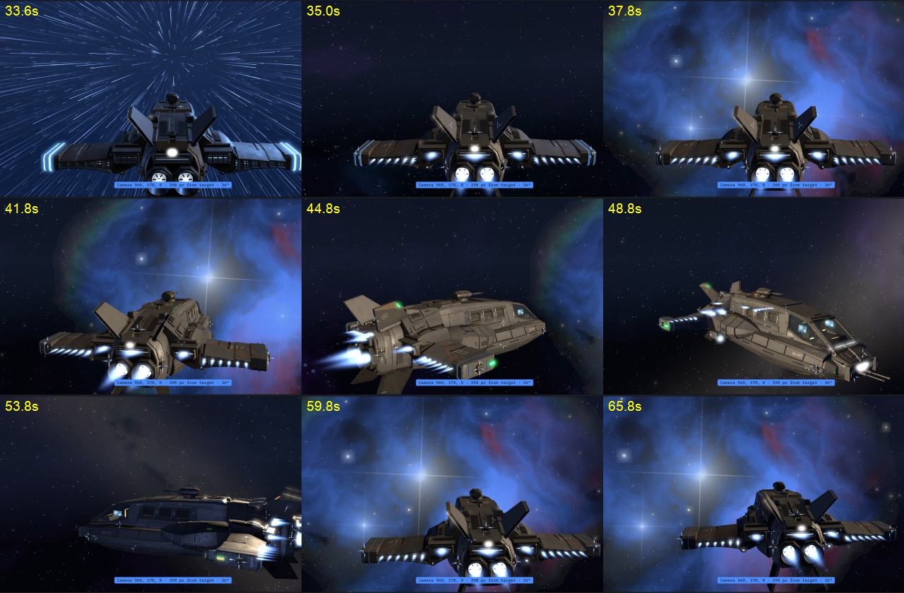
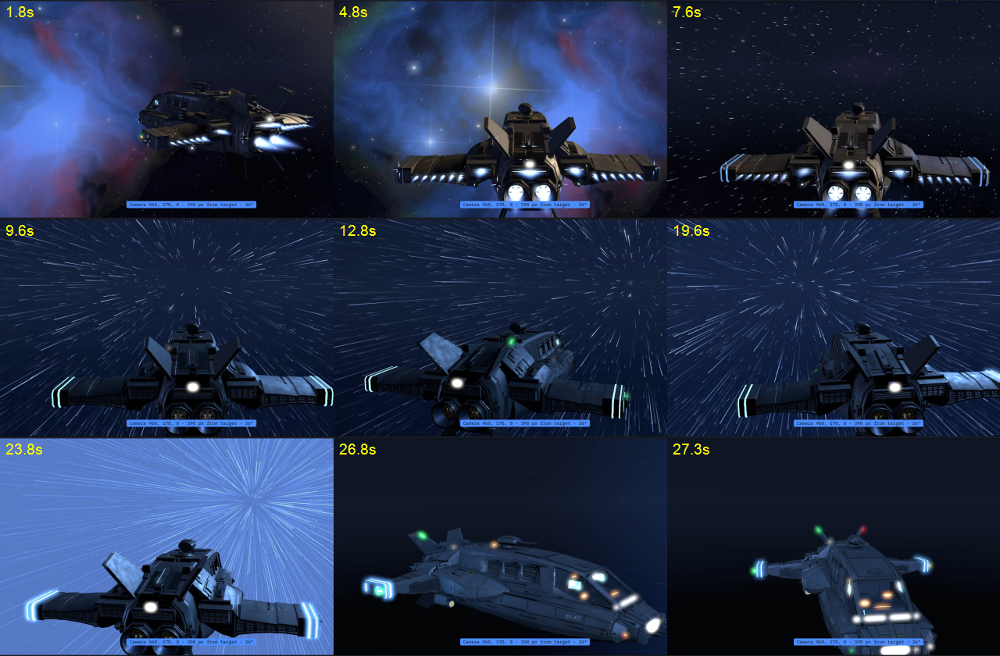
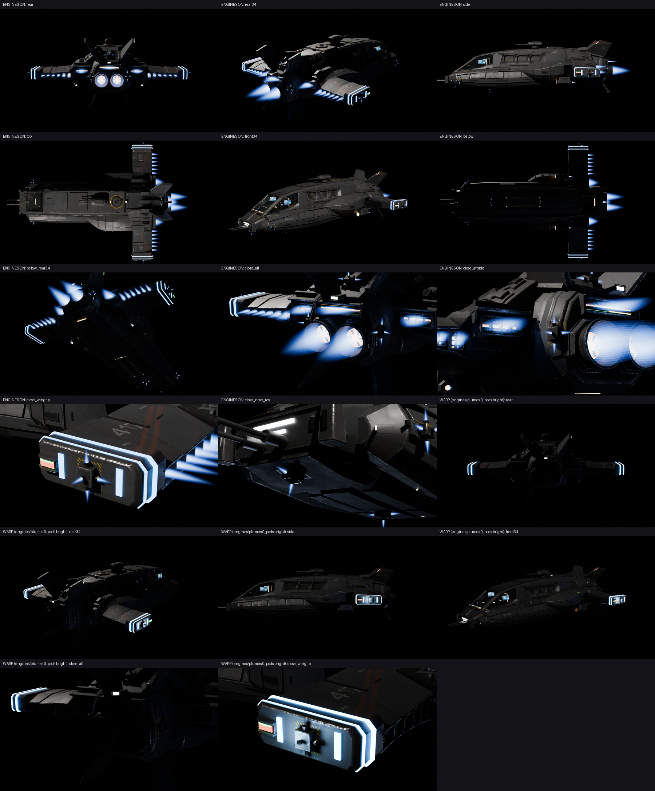
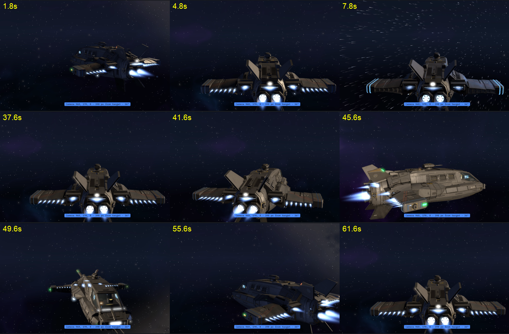
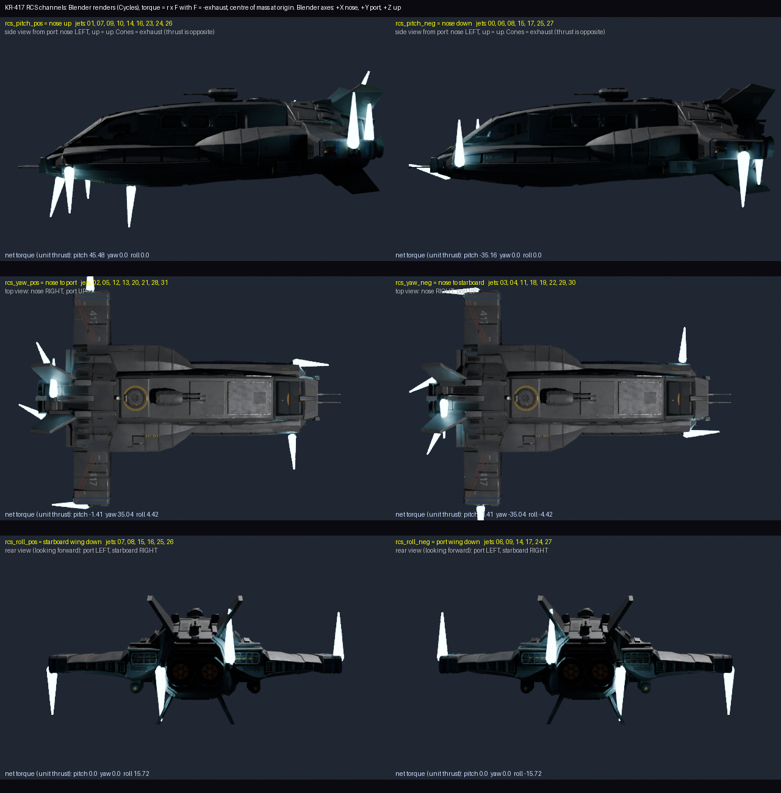
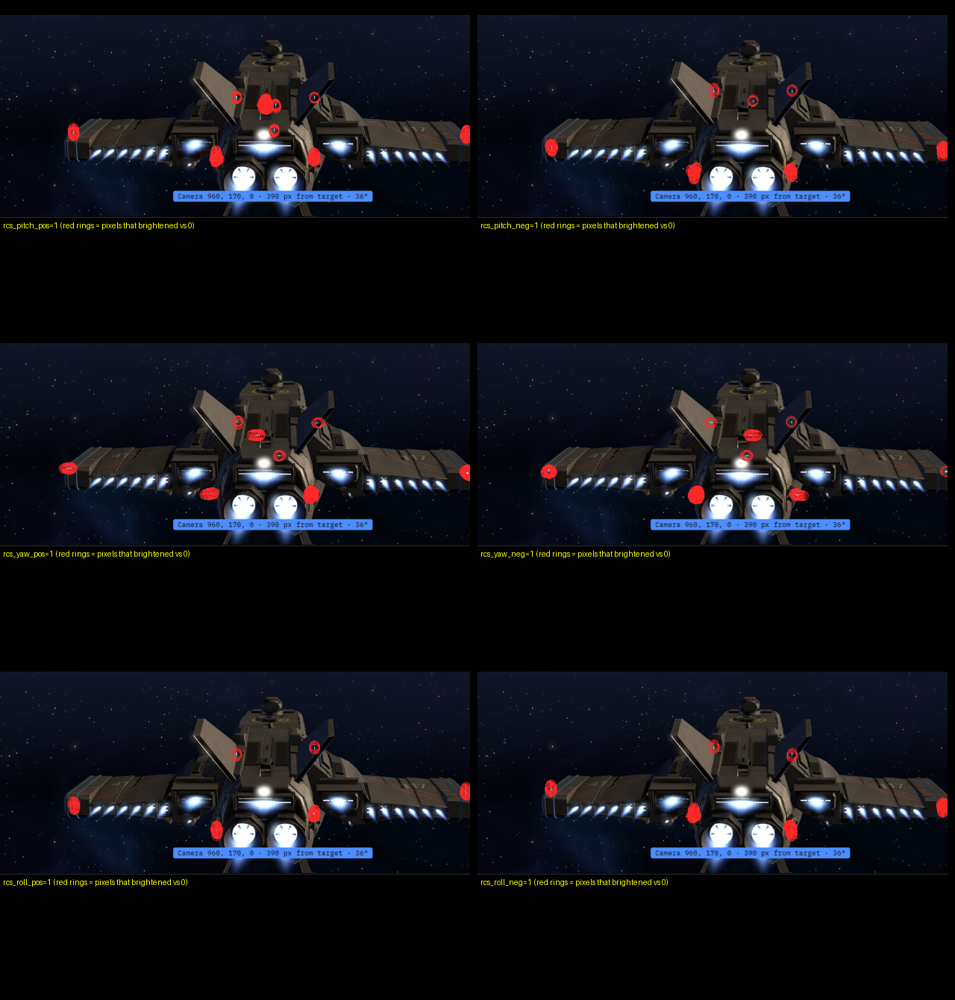
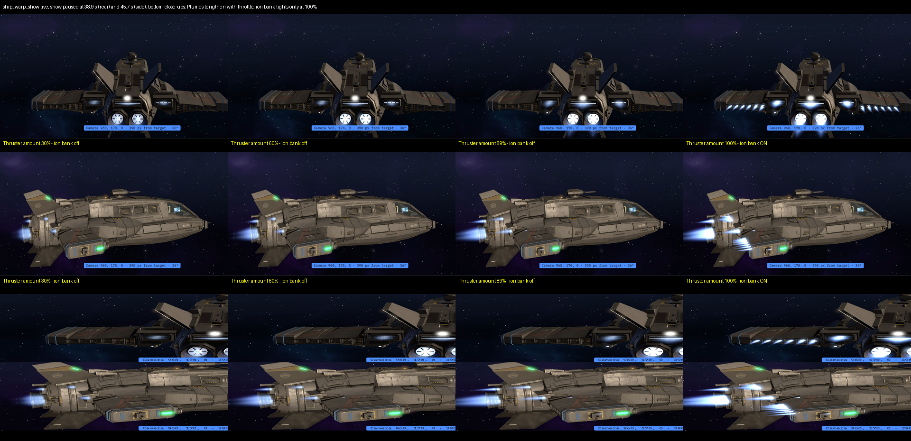
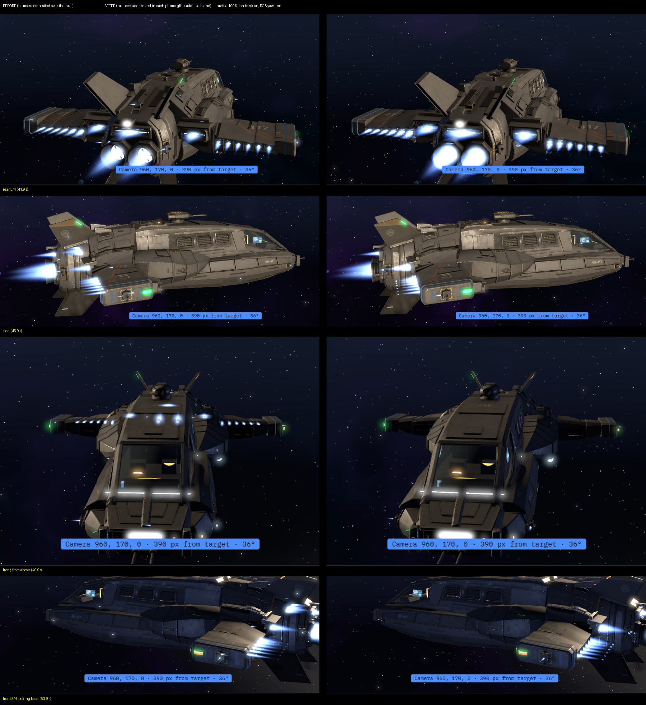

# KR-417 ship

The KR-417 exterior starship for [JStream](https://github.com/jeffmhopkins/JStream): a 2K glTF model with engine plumes, pulsing warp-pod rings and physically mapped RCS jets, plus a 68.6 s looping warp show (`kr417_warp_show`).

This folder is only the exterior ship and its warp show. It does not change the DAW cockpit, `s_3d`, or the cockpit sky source `l_env` and its `warp` channel.

The JSON under `jstream/` is a read-only export of the live collection originally taken at state `rev` 1457 on Thursday 26 Nov 2026 at about 9:34 PM (America/New_York). Model paths and files were updated to the plain `*_nodiamond.glb` plumes and RCS jets that the live collection uses at `rev` 1491 (Friday 27 Nov 2026). Runtime channel values and the show clock are not included. The `_occ` hull-copy workaround described below has been retired.

| | |
|---|---|
|  |  |
| At warp | The model |

## Setup

The live project that these objects were exported from is `C:\ai\scenes\cockpit\jstream-demos.json`. Its collection asset root is `C:\ai\scenes\cockpit\`, and the models lived in `C:\ai\scenes\cockpit\spaceship\` as collection-relative paths such as `spaceship/spaceship_r15_ship_2k_d.glb`.

In the exported source JSON those paths have been rewritten to:

`{SCENES}/kr417-ship/models/<filename>.glb`

`{SCENES}` is a placeholder for the StreamingScenes checkout (the repo root). No device token or other secret is in this folder.

This show is not part of [`jstream-demos.json`](../jstream-demos.json). That file is the feature tour and the DAW cockpit, rebuilt by `tools/build_demos.py`. Load this one by importing the JSON below.

To load the show in JStream:

1. This folder already sits beside [`starship-cockpit`](../starship-cockpit/), [`cockpit-3d`](../cockpit-3d/), [`feature-tour`](../feature-tour/) and [`camera-demos`](../camera-demos/). The twelve glbs are in [`models/`](models/).
2. Fix the asset paths in [`jstream/sources.json`](jstream/sources.json) so they match where the engine will read the glbs:
   - **With the repo as the collection asset root** (the same way `jstream-demos.json` finds the cockpit model, by paths from the checkout): replace `{SCENES}` with `.` (or the absolute checkout path) so a file reads `{SCENES}/kr417-ship/models/spaceship_r15_ship_2k_d.glb` → `kr417-ship/models/spaceship_r15_ship_2k_d.glb`.
   - **Dropped into an existing collection folder** (as on the live machine): copy the glbs into `<asset-root>/spaceship/` and restore the original form `{"type":"asset","root":"collection","path":"spaceship/<filename>.glb"}`.
3. Import the JSON into the project, in this order, creating objects that do not already exist:
   - `jstream/channels.json` — 24 channels (6 of them auto-follow `ship_thrusters`)
   - `jstream/sources.json` — 17 sources (ship, four plume-length tiers, ion bank, six RCS groups, sky, sun, fill, warp light, pod light)
   - `jstream/scene.json` — scene `ship_warp_show` with its items, the `ws_bloom` depth-bloom filter, camera, camera motion modifiers, and the stored copy of timeline `ws_show`
   - `jstream/timeline.json` — standalone copy of `ws_show` (68.6 s, loop), same object as the one on the scene
   - `jstream/show.json` — show `kr417_warp_show`: one 68.6 s clip of `ship_warp_show`, cut, looping, bookmark `b_start` at 0 s (non-pausing) which plays `ws_show`
4. Canvas size for this show is 1920×1080. Keep the scene camera at **fov 36°** and a viewing distance around **1700 px** (see [Known engine bugs](#known-engine-bugs-and-workarounds)).

`jstream/export_meta.json` records the original paths, the rev, and the source and channel IDs that were exported. `jstream/show_rebuild/` holds the Python generators (`gen.py`, `gen2.py`, `gen3.py`, `gen_engines.py`), the latest generated timeline (`timeline9.json`, the 68.6 s loop with engine lanes), and the batches that built it (`batch_2stage`, `batch_sunoff`, `batch_turn30` + `batch_turn30_motion`, `batch_engines` + `batch_engines_motion2`, `batch_rcs`, `batch_throttle` + `batch_throttle2`, `batch_occlusion`). Older timelines, cam-motions and `test_*` files were left out. The live `jstream/timeline.json` is the source of truth if it and `timeline9.json` ever differ.

`blender/work15/` and `blender/work16/` are the scripts that split and retint the r15 ship, build the plume length tiers, split the RCS jet groups, and (historically) merge a colorless hull copy into each plume/RCS glb (`occl_build.py`, `merge_occ.py` and friends). Those hull-copy `_occ` files are retired; the live show uses the plain `*_nodiamond.glb` models. `blender/build_ship.py` and `build_ship_r*.py` are the earlier model-build scripts. Scratch renders, API schema dumps and `r15_report.json` (raw nozzle/pod coordinates) are not included.

## Channels

All channels are 0–1. Collection-wide (no `scene_id`), so they can also be set by hand when the show is stopped. `thr_tier1`–`thr_tier4` and `thr_ion` are automatic followers of `ship_thrusters`; do not drive them from the timeline.

| ID | Label | Range | Default | What it does |
|---|---|---|---|---|
| `ship_thrusters` | Thruster amount | 0–1 | 1 | True throttle. Scales main-engine / impulse / wing-root / pod-end glow and which plume-length tier is visible. 1 in cruise; the show ramps it to 0 for warp and back to 1 on drop-out. |
| `ship_warp_pods` | Warp pod glow | 0–1 | 0 | Wingtip pod ring glow and pod point-lights, plus a 1 s pulse. The show goes 0 → 0.5 with the first warp ramp, then → 1 with the second, and back to 0 on drop-out. |
| `thr_tier1` | Plume tier 25% length (auto from Thruster amount) | 0–1 | 0 | Auto. Crossfade weight for the 25% plume item. Peaks at 25% throttle, 0 at 0% and at 50% and above. |
| `thr_tier2` | Plume tier 50% length (auto from Thruster amount) | 0–1 | 0 | Auto. Peaks at 50% throttle. |
| `thr_tier3` | Plume tier 75% length (auto from Thruster amount) | 0–1 | 0 | Auto. Peaks at 75% throttle. |
| `thr_tier4` | Plume tier 100% length (auto from Thruster amount) | 0–1 | 1 | Auto. 0 until 75%, ramps to 1 at 100%. Source `ws_plumes` uses `plume_t100_nodiamond.glb`. |
| `thr_ion` | Ion bank gate (auto: 0 at ≤90% thrust, 1 at 100%) | 0–1 | 1 | Auto. The two six-nozzle ion banks on the back of the wings: 0 at 90% throttle or less, full at 100%. |
| `rcs_pitch_pos` | RCS pitch + (nose up) | 0–1 | 0 | Fires only the pitch-up jets. Off by default; not driven by the show timeline. |
| `rcs_pitch_neg` | RCS pitch − (nose down) | 0–1 | 0 | Pitch-down jets. |
| `rcs_yaw_pos` | RCS yaw + (nose to port) | 0–1 | 0 | Yaw-to-port jets. |
| `rcs_yaw_neg` | RCS yaw − (nose to starboard) | 0–1 | 0 | Yaw-to-starboard jets. |
| `rcs_roll_pos` | RCS roll + (starboard wing down) | 0–1 | 0 | Roll jets in diagonal pairs (pitch cancels). |
| `rcs_roll_neg` | RCS roll − (port wing down) | 0–1 | 0 | Opposite diagonal roll pair. |
| `ws_warp` | Warp show: warp | 0–1 | 0 | Sky warp streaks and the ship's interior warp-spool glow. 0 → 0.5, then → 1, then drop out. |
| `ws_sunfade` | Sun off in warp | 0–1 | 0 | 0 = warm sun on, 1 = fully off. The sun item's base intensity is 0; a modifier adds the on level when this channel is 0. |
| `ws_yaw` | Ship heading turn | 0–1 | 0 | Turns the ship (and the plume / RCS / pod items) +30°, and the camera path follows. Also drives the approximate pod-light follow. |
| `ws_skyturn` | Warp heading (sky turn) | 0–1 | 0 | Turns the sky so the warp vanishing point matches the new heading. |
| `ws_intro` | Warp show: intro move | 0–1 | 0 | Swing-in / dolly-in, and the matching pull-back at the end of the loop. |
| `ws_orbit` | Warp show: orbit | 0–1 | 0 | Each 360° orbit segment (two at warp, one in normal space). |
| `ws_shake` | Warp show: shudder | 0–1 | 0 | Entry / steady / drop-out camera shudder. |
| `ws_cpx` | Warp show: camera x | 0–1 | 0.5 | Camera path position X (dense keyed lane). |
| `ws_cpz` | Warp show: camera z | 0–1 | 0.5 | Camera path position Z. |
| `ws_ctx` | Warp show: look x | 0–1 | 0.5 | Camera look-at X. |
| `ws_ctz` | Warp show: look z | 0–1 | 0.5 | Camera look-at Z. |

## Show beat list (68.6 s loop)

Times are from the start of `ws_show`. The show clip length is 68.6 s, end action is loop, transition is cut.

| Time | What happens |
|---|---|
| 0–5.0 s | Swing in (35° → 0°) and dolly closer (`ws_intro` 0 → 1). Thrusters at 100% cruise, pods off, sun on, heading 0°. |
| 4.0–8.5 s | Ship and camera slowly turn 30° away from the sky's focal point (`ws_yaw`, ease in-out). |
| 6.5–9.5 s | Warp 0 → 50%, starting with about 10° of the turn left. Half push. Entry shudder 0.5 (peak 8.1–9.5 s), easing to the steady 0.25 by 11.0 s. Sun fades off (`ws_sunfade` 0 → 1) and stays off through both warp stages. Thrusters 1 → 0; pods 0 → 0.5. |
| 7.0–9.5 s | Sky / warp direction turns 30° (`ws_skyturn`) so the streaks' vanishing point lines up with the new heading. |
| 10.0–21.5 s | 360 #1 at 50% warp (steady shudder 0.25). |
| 18.7–21.5 s | Warp 50 → 100% (starts about 20.8° before 360 #1 ends). Strong shudder 1.0 from 19.3 s, easing to the steady 0.5 by 23.0 s. Pods 0.5 → 1. |
| 21.5–33.0 s | 360 #2 at 100% warp (steady shudder 0.5). |
| 33.0–35.5 s | Drop out (zoom back). Shudder 0.5 through 34.6 s, then 0 by 36.0 s. Sun returns. Thrusters 0 → 1; pods 1 → 0; warp 1 → 0. |
| 36.0–63.6 s | Normal 360. |
| 63.6–68.6 s | Pull back and turn back to the start pose (facing the focal point). `ws_yaw` and `ws_skyturn` unwind with `ws_intro`. Then the loop restarts. |

The arrival / point-of-interest pictures on this show's sky (`ws_sky_env`) are off (`sky_pictures: null`). Stars, nebula and the galaxy band stay. That change is only on this show's sky, not on the cockpit's `l_env`.

## RCS nozzle-to-channel mapping

32 RCS nozzles, off by default, and they no longer follow Thruster amount. Each channel drives its own plume + glow item (`sw_rcs_<group>`), fully invisible at 0 (opacity and glow both to zero, no haze). Torque is computed as r × F, with thrust opposite the exhaust. Roll uses diagonal pairs so the jets do not also pitch or yaw the ship.

| Channel | Nozzles |
|---|---|
| `rcs_pitch_pos` (nose up) | RCS_01, 07, 09, 10, 14, 16, 23, 24, 26 |
| `rcs_pitch_neg` (nose down) | RCS_00, 06, 08, 15, 17, 25, 27 |
| `rcs_yaw_pos` (nose to port) | RCS_02, 05, 12, 13, 20, 21, 28, 31 |
| `rcs_yaw_neg` (nose to starboard) | RCS_03, 04, 11, 18, 19, 22, 29, 30 |
| `rcs_roll_pos` (starboard wing down) | RCS_07, 08, 15, 16, 25, 26 |
| `rcs_roll_neg` (port wing down) | RCS_06, 09, 14, 17, 24, 27 |

Plus and minus sets mirror each other. The six groups are separate glbs: `rcs_pitch_pos_nodiamond.glb` and so on. A Blender check sheet is [`stills/rcs_channels.png`](stills/rcs_channels.png); a live check of each channel is [`stills/jstream_rcs_live.png`](stills/jstream_rcs_live.png). The optional yaw puffs during the 30° pre-warp turn were left out, so the yaw channels stay off the timeline.

## Throttle behaviour

`ship_thrusters` is a true throttle: glow on the main engines, impulse slot, wing-root thrusters and pod-engine ends scales with it, and the exhaust plume gets longer and brighter. The plumes stay attached at the nozzle exits. They are not camera-facing billboards.

Length is a four-tier crossfade, each tier its own item and glb, all fitted to the same bounds as the ship (item size 1763.07 × 1007.47, turn 90°, so they land on the 1400 × 800 ship):

| Throttle | Visible plume item | Source / file |
|---|---|---|
| ~25% | `sw_plume_t025` | `ws_plume_t025` → `plume_t025_nodiamond.glb` |
| ~50% | `sw_plume_t050` | `ws_plume_t050` → `plume_t050_nodiamond.glb` |
| ~75% | `sw_plume_t075` | `ws_plume_t075` → `plume_t075_nodiamond.glb` |
| 100% | `sw_plumes` | `ws_plumes` → `plume_t100_nodiamond.glb` |

The auto channels `thr_tier1`–`thr_tier4` are a `min` (or, for tier 4, a single remap) of `ship_thrusters` so neighbouring tiers crossfade and only one length is fully on at a time. Item opacity on each tier follows its auto channel (a single opacity modifier per item; see bugs below). Emissive strength on the plume materials uses add mode from a rest value of 1: −1 is off, 0 is the file strength.

The ion bank (12 nozzles, six on the back of each wing) is a separate item `sw_plume_ion` / `plume_ion_nodiamond.glb`, gated by `thr_ion`. That channel remaps `ship_thrusters` so it is 0 at 90% or less and 1 at 100%. The banks are therefore on in the show's cruise (throttle stays at 100% outside warp) and off below that.

Checked live at 30%, 60%, 89% and 100%: [`stills/jstream_throttle.png`](stills/jstream_throttle.png). The four plume-tier items, the ion bank and the six RCS items all use **additive** blend. On a JStream build with shared scene depth ([#1836](https://github.com/jeffmhopkins/JStream/pull/1836)), the hull is in the same depth buffer, so the exhaust is hidden where the ship is in front. See [Plain plumes and the retired occlusion workaround](#plain-plumes-and-the-retired-occlusion-workaround).

## Models in this folder

Only the assets the live show still references. Filenames match the sources.

| File | Used by |
|---|---|
| [`spaceship_r15_ship_2k_d.glb`](models/spaceship_r15_ship_2k_d.glb) | `ws_ship_r15` (item `sw_ship`) |
| [`plume_t025_nodiamond.glb`](models/plume_t025_nodiamond.glb) / [`t050_nodiamond`](models/plume_t050_nodiamond.glb) / [`t075_nodiamond`](models/plume_t075_nodiamond.glb) / [`t100_nodiamond.glb`](models/plume_t100_nodiamond.glb) | the four length tiers; `ws_plumes` is the 100% file |
| [`plume_ion_nodiamond.glb`](models/plume_ion_nodiamond.glb) | `ws_plume_ion` |
| [`rcs_pitch_pos_nodiamond.glb`](models/rcs_pitch_pos_nodiamond.glb) and the other five `rcs_*_nodiamond.glb` | the six RCS source / item pairs |

The combined files `ship_plumes.glb` and `ship_plumes_main.glb`, the 39.7 MB full-resolution `spaceship_r15.glb` and the Blender `.blend` are not referenced and are not in `models/`. The eleven `*_occ.glb` hull-copy files are also omitted: they z-fight when models share one depth. Every file is under 20 MB. `models/` is about 21 MB. On the live machine the same glbs live under `spaceship/`, and the collection references `spaceship/*_nodiamond.glb`. The unsuffixed copies there (`plume_ion.glb` and so on) are byte-identical to the nodiamond files.

## Plain plumes and the retired occlusion workaround

JStream used to draw each model item as its own layer, with its own depth buffer, and composite those layers in centre-depth order. A plume or RCS jet in a separate glb was therefore not hidden by the ship's hull: the exhaust could show through the body. That followed ADR-0107 decisions 6 and 7 (a model's layer is not depth-tested against other models). Putting the ship and the plumes in a `share_space` group did not change that.

The workaround was a colorless hull copy inside each of the eleven plume, ion and RCS glbs: an exact copy of the hull (about 36k triangles), black, unlit and opaque (`kr_occluder`). Inside that one model, ordinary mesh depth hid the exhaust where the hull was in front. Those eleven items used **additive** blend, so the black hull copy added nothing and stayed invisible against the real ship.

[JStream #1836](https://github.com/jeffmhopkins/JStream/pull/1836) draws every model that can share a 3D scene into one colour target and one depth. The hull then hides the exhaust by ordinary depth, so the plain plumes are enough. The `_occ` hull copies z-fight on that path and must not be used with it.

The current glbs also fix two artefacts in the plain plume and RCS models. Tip UVs are clamped so the plume texture does not wrap around into a small detached nozzle-coloured diamond just past the fade. The BoundsMarker mesh is fully transparent so it cannot sparkle near the wingtips.

The still of the old hull-copy workaround, at four angles, with throttle at 100%, the ion bank on and RCS yaw+ on, is kept for history: [`stills/jstream_occlusion.png`](stills/jstream_occlusion.png).

## Known engine bugs and workarounds

- **[JStream #1835](https://github.com/jeffmhopkins/JStream/issues/1835) — `mode: "replace"` is a no-op on a model's `emissive_strength`.** The modifier is stored, but the material keeps the glow strength from the glTF file. **Workaround:** use add mode (the default) from a rest value of 1: `from: -1` is off, and `to: N-1` gives strength N. Every glow and plume modifier in this show is written that way. For the pods, −1 → +0.28 (×0 to ×1.28) plus a 1 s sine pulse of ±0.32 scaled by `ship_warp_pods`.

- **Opacity modifiers multiply.** If two opacity modifiers sit on the same item, each scales the other, so a “fully on” item can still be dim or invisible. Each fading item in this show uses a single opacity modifier.

- **[JStream #1834](https://github.com/jeffmhopkins/JStream/issues/1834) — the model can drop out of the live program render when it is small on screen or at certain angles.** Snapshots and `video.frames` still show it; only the live canvas misbehaves. **Workaround:** keep fov at 36° and a viewing distance around 1700 px. Wider fov (45°) at ~1950 px was enough to make this ship vanish from dead behind.

- **Shared depth between model items ([JStream #1836](https://github.com/jeffmhopkins/JStream/pull/1836), not yet merged as of 27 Nov 2026).** On a build with that change, models in one 3D scene share a depth buffer, and this show uses the plain `*_nodiamond.glb` plumes. The `_occ` hull-copy files z-fight there. On an older build that still composites each model into its own layer, the exhaust can show through the hull unless those `_occ` files are restored.

- **Pod light follow is approximate.** The two pod point-lights (`sw_pod_L`, `sw_pod_R`) are not parented to the pod nodes. They follow the 30° heading turn with `x` and `depth` modifiers on `ws_yaw`, which is close but not a true orbit around the ship's centre. Fine for this show's turn; it will drift if you add a much larger heading change.

The live collection also still has two unused leftover group scenes from an earlier camera-rig approach, `ws_rig` (empty) and `ws_world` (five older items). They are not referenced by `ship_warp_show` and were not exported.
