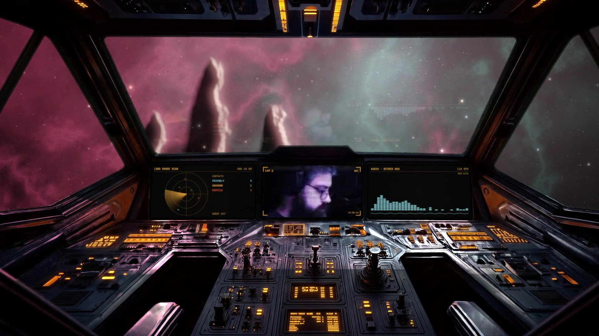
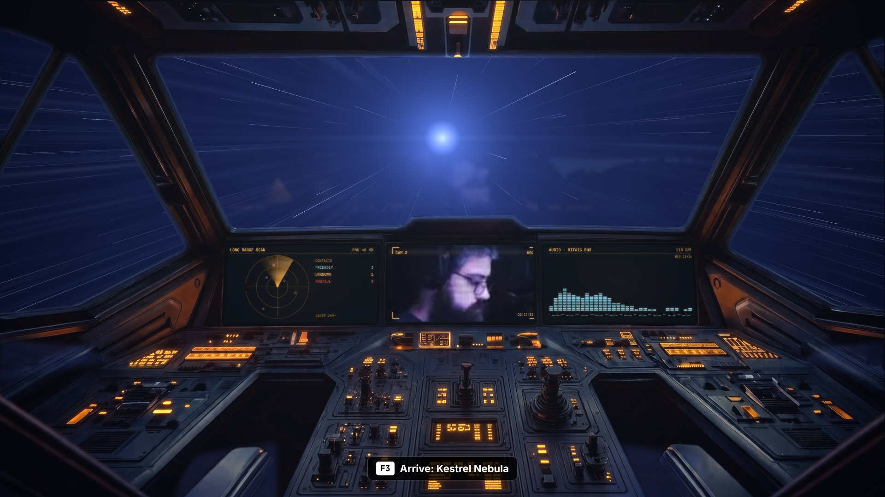

# Starship cockpit

A photoreal starship cockpit for live streams. Your cameras play on its monitors, which can
also show radar, engineering, an audio spectrum, navigation or shields. Through the windows
is real-looking space, at one of three locations. On demand the ship can:

- **warp** from one location to another;
- **fire on an asteroid** and blow it up;
- **take fire**;
- **receive a transmission**, a caller shown as a hologram;
- **raise a hologram of the Bitwig session**.

The cockpit sways slightly, as if you were sitting in it. Its amber lights pulse with the
music. The space outside reflects in its glossy surfaces and lights them: hyperspace blue,
a laser flash, the orange of an explosion.

## Demo

[`media/cockpit-demo.mp4`](media/cockpit-demo.mp4) runs through every effect in under a
minute. It was rendered in Chromium, from these same pages stacked as the JStream scene
stacks them and switched on the hotkey timeline. JStream draws browser sources only on
Windows, so the scene hasn't been seen inside JStream yet.

The camera monitors show stills from Jeff's January stream. The hologram caller is a still
from his May stream, and the Bitwig hologram is a crop of the January stream's Bitwig
screen. All of them stand in for live sources.

## How it's built

Every moving part is an HTML page shown in a JStream `browser` source. All the pages use one
clock, the wall clock (`Date.now`), so separate sources stay in step without talking to
each other. That clock drives:

- the cockpit's sway;
- the ship's drift against the sky;
- the music the lights follow;
- the windows' mask.

`pages/ship.js` holds what they share:

- the clock, the sway and the ship's attitude;
- the simulated music;
- `Outside`, the compositor every outside layer draws through.

`Outside` masks a layer to the windows, which move with the sway, then draws the light
the layer throws into the cockpit.

**Reflections** are one layer, not each page's own (`pages/refl.js`, masks from
`tools/masks2.py`). Round 3 had every outside page reflect itself. So while a warp-out
still covered the window, the destination sky under it was already reflecting its stars
on the dash. Now one layer mirrors the composite that actually shows through the glass,
whatever is stacked there, onto three specific masks. In the still below, a warp-out still covers
the window, and the dash reflects only the warp:

- `m-console.png`: the ledge under the monitors, the side sills and the seat bolsters.
  The outside is mirrored and squashed about the dash line, with a fresnel ramp.
- `m-edge.png`: the window frame bevels. The outside is blurred so it bleeds onto them as
  rim light, which is what flashes, lasers and explosions catch.
- `m-glass.png`: the glass itself. It faintly ghosts the lit interior, meaning the
  monitors and the holograms, mirrored about the window's lower edge.

In the demo, `demo.html` reads the shown pages' canvases to build it. In JStream it maps
to native parts: a `scene` source of the outside layers placed with `flip_v` and a
squashed scale, with `blur` and `image_mask` on the source's chain (drawn since #1036),
and an `additive` blend. A second one does the same for the monitors and holograms.

**Music.** It's simulated for now: 118 BPM, with a kick, snare, hats, bass and pad, and a
4-bar breakdown every 16 bars. When JStream can give a page audio levels, `audio(s)` in
`ship.js` is the one function to replace.

### Layers, bottom to top

All are 1920 × 1080, placed full-frame, unless the table says otherwise. A **Restart**
layer has `restart_on_show` on and starts hidden. Layers 1 to 3 and the caller sit under
the cockpit; everything else draws over it.

| # | Layer | Source | Restart | Notes |
|---|---|---|---|---|
| 1 | Black | `color` #000 | | |
| 2 | Monitors 1 to 3 | your cameras | | Placed 8 px larger than the screens, so the sway never shows an edge: (482, 523, 345 × 184), (835, 523, 333 × 183), (1174, 523, 342 × 184). |
| 3 | Monitor pictures | `screen-*.html`, 690 × 368 each | yes | Placed in the same boxes as layer 2. `screen-camhud-N` frames a camera; `radar`, `telemetry`, `spectrum`, `nav` and `shields` replace it. Each powers on like a CRT when shown. |
| 4 | Cockpit | `cockpit.html` | | The keyed cockpit, its sway, and its music-driven lights. |
| 5 | Sky | `sky-deep.html`, `sky-nebula.html`, `sky-planet.html` | | One shown per location. |
| 6 | Warp | `warp-in-<from>.html`, `warp-out-<to>.html` | yes | `warp-in` covers the windows with hyperspace. `warp-out` drops into its location's sky and, once it ends, matches the sky page exactly. |
| 7 | Weapons | `attack.html` | yes | About 7 s: lock-on, four laser volleys, the explosion. Clears itself. |
| 8 | Caller | the caller's camera at (700, 130, 520 × 292) | | Blend **screen**, opacity 75%. A **color correction** filter with saturation -1 and multiply `#78dcff`. Fades in after 1700 ms. |
| 9 | Bitwig | a window capture of Bitwig at (600, 84, 720 × 405) | | The same blend and filter as the caller. Fades in after 1100 ms. |
| 10 | Taking fire | `hit.html` | yes | Emergency lighting and smoke stay on until it's hidden. |
| 11 | Transmission | `transmission.html` | yes | |
| 12 | Bitwig frame | `bitwig.html` | yes | |

The pages read their images from beside them, so load them with `file`, not `html`. The
art is in `pages/`:

- `cockpit.png`, Jeff's green-screen cockpit plate with the green keyed out;
- the three sky plates (`stars.jpg`, `nebula.jpg`, `planet.jpg`);
- the masks (`m-window.png`, `m-gloss.png`, `lights.png`);
- `rock.png` and `debris.png`, the asteroid and its pieces.

### Variants and hotkeys

JStream hotkeys can only switch scenes, so each combination of location and effect is a
keyframe variant of the cockpit scene. Each one shows the layers it needs:

- **At each location:** Cruise, Weapons, Taking fire, Transmission and Bitwig. Each shows
  that location's sky and its `warp-out` page. `warp-out` stays shown, so returning to
  Cruise doesn't play the drop out again.
- **Warp from each location:** shows `warp-in-<from>` over the old sky.
- **Arriving:** switching from a Warp variant to a location's Cruise shows its
  `warp-out-<to>`, which plays the drop out.
- **Monitor sets** are more variants (Cams, Scan, Nav), or a nested scene per monitor whose
  variants pick its picture.

The demo uses these keys: F1 Cruise, F2 Warp, F3 Arrive, F4 Taking fire, F5 Transmission,
F6 and F7 monitor sets, F8 Weapons, F9 Bitwig. With three locations, a Stream Deck page per
location is easier than one hotkey per variant.

## Tools

- `tools/` holds the Python that made the art:
  - `common.py`, `plate.py`, `nebula.py` and `planet.py` make the sky plates;
  - `rock.py` makes the asteroid and debris;
  - `masks.py` makes the window, gloss and light masks from `cockpit.png`.
- `tools/rec.js` and `tools/vt.js` record the demo with Playwright on a virtual clock,
  frame by frame, and `tools/quick.js` renders one still.
  - `pages/demo.html` stacks the layers as the scene does.
  - The `cam*.png`, `caller_holo.png` and `daw_holo.png` stand-ins sit beside it.
  - To record, serve `pages/` with `python3 -m http.server 8767`, then run
    `node tools/rec.js` from `pages/`. It writes frames to `f/`.

## What this scene taught us about JStream

These notes feed the review of what should be native and what should stay in HTML:

- **Hotkeys only switch scenes.** Location × effect turns into dozens of variants. A hotkey
  action that shows or hides one item would remove most of them.
- **Nothing moves continuously.** The sway, the drift and the pulsing lights had to be
  HTML. A native noise or wiggle on an item's transform, and looping keyframe tracks, would
  cover them.
- **A page can't see other sources.** So per-page reflections went wrong whenever layers
  stacked (round 3's warp-out bug). Reflections belong native: a `scene` source of what
  they mirror, with `flip_v`, `blur`, `image_mask` and an `additive` blend, all of which
  exist now.
- **Shaders:**
  - The warp, the tunnel, the zoom blur and the fireball belong in a native shader source,
    with multipass, feedback, textures and audio.
  - WGSL effect packs exist today, but only as single-pass filters, and an agent can't
    write one over MCP.
- **Audio** has to be simulated: pages can't hear the mix.
